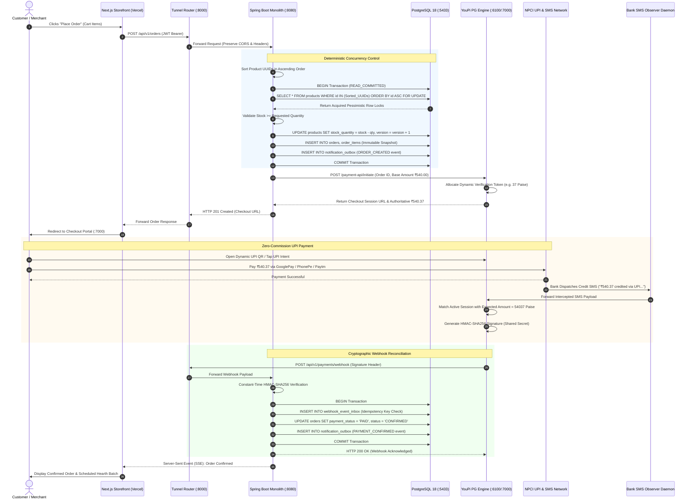
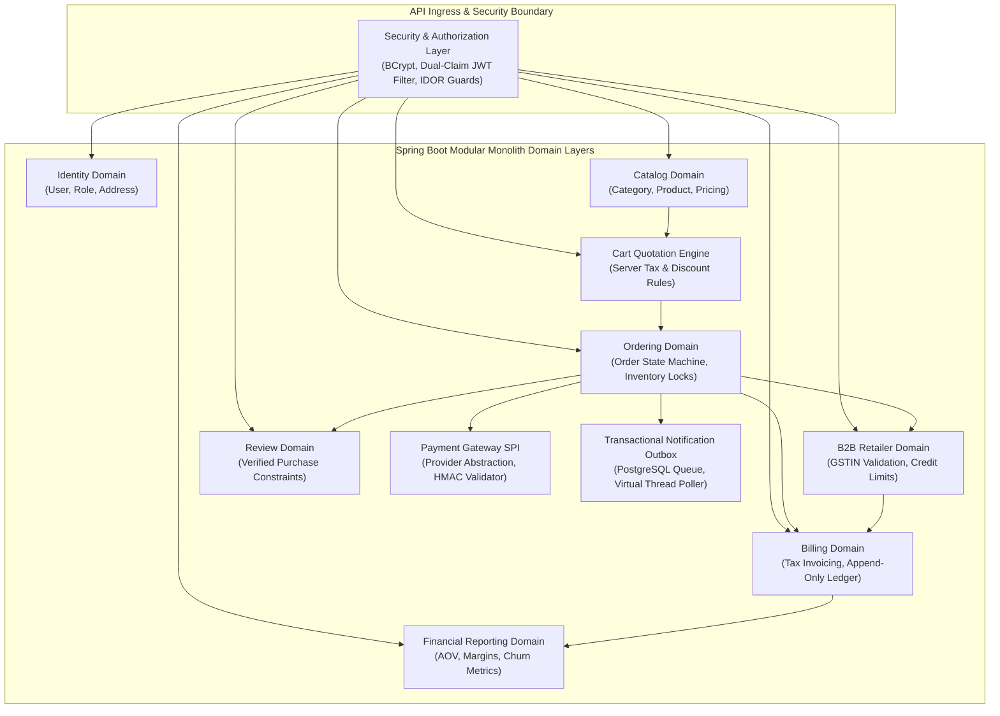
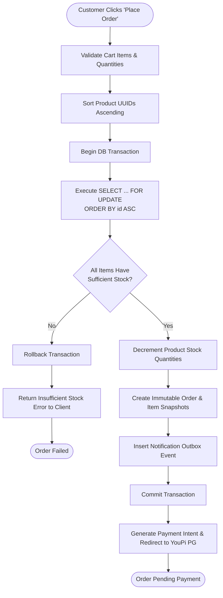
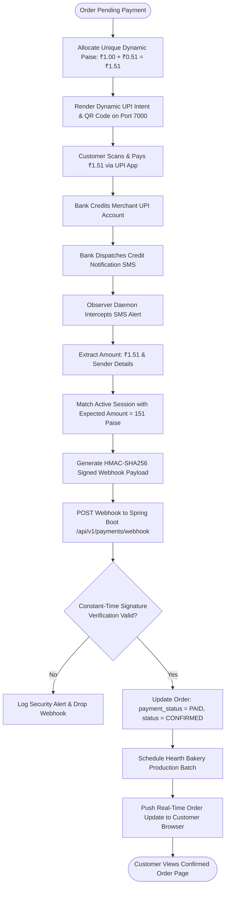
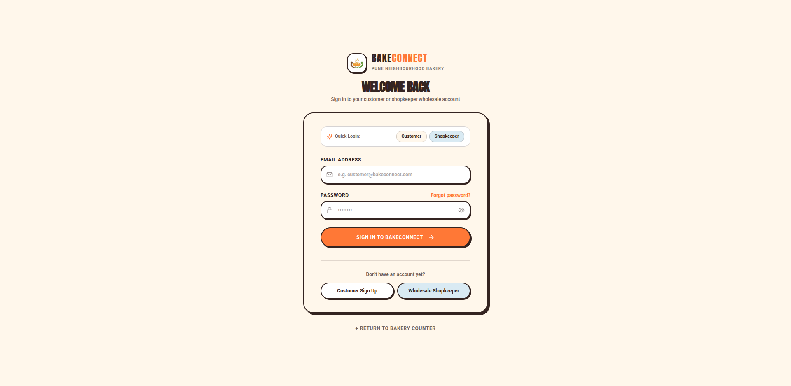
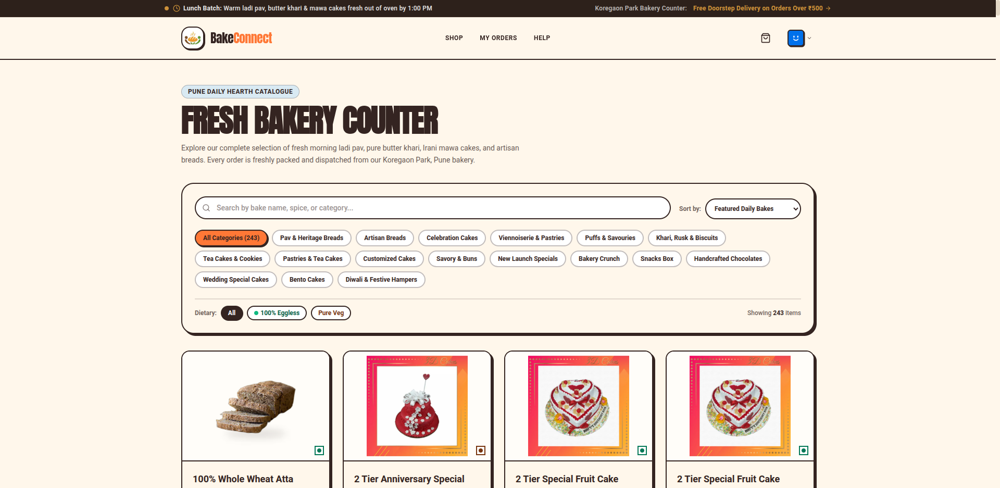
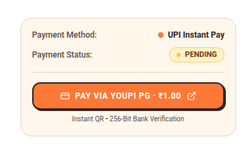
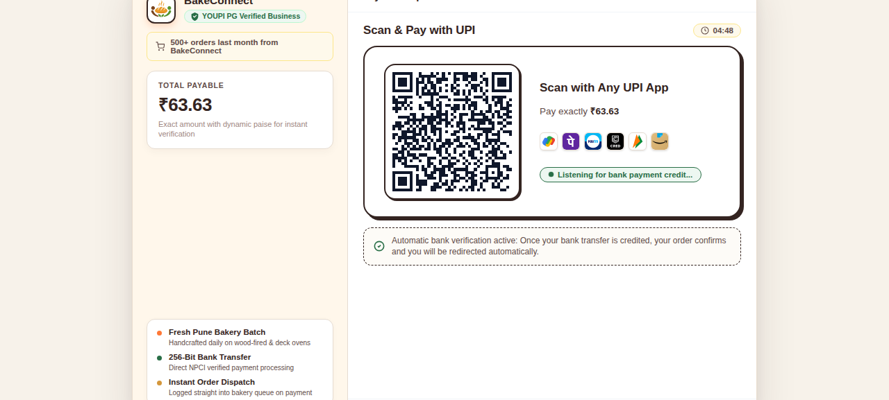
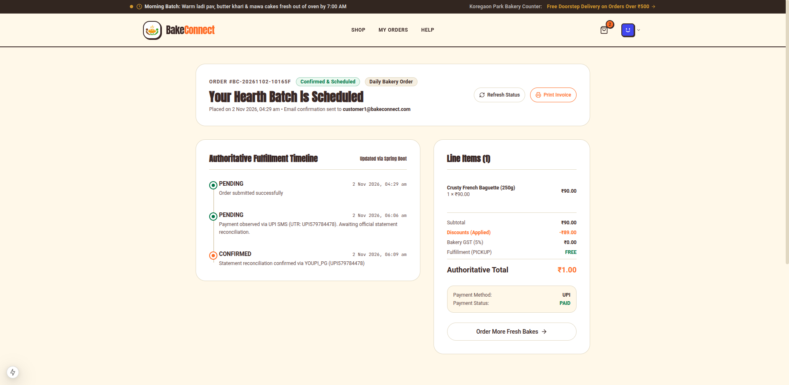

# BakeConnect — Comprehensive Capstone Project & System Engineering Report

> **A High-Concurrency Bakery Distribution & Direct Ordering Management System**  
> *Monolith Backend in Spring Boot 3.4 (Java 21 Virtual Threads) & PostgreSQL 18 with Strict Cache-Only Redis, Next.js 15 Storefront on Vercel, and Proprietary YouPi PG Dynamic UPI Reconciliation.*

---

## Table of Contents
- [Chapter 1: System Overview & Project Scope](#chapter-1-system-overview--project-scope)
- [Chapter 2: System Architecture](#chapter-2-system-architecture)
  - [2.1 Multi-Tier Architecture Topology](#21-multi-tier-architecture-topology)
  - [2.2 Ingress & Reverse Proxy Topology](#22-ingress--reverse-proxy-topology)
  - [2.3 End-to-End Concurrency & Payment Reconciliation Lifecycle](#23-end-to-end-concurrency--payment-reconciliation-lifecycle)
  - [2.4 Modular Monolith Domain Boundaries & Dependency Model](#24-modular-monolith-domain-boundaries--dependency-model)
  - [2.5 Architectural Invariants & Non-Functional Guarantees](#25-architectural-invariants--non-functional-guarantees)
- [Chapter 3: Database Design](#chapter-3-database-design)
  - [3.1 Entity-Relationship (ER) Diagram](#31-entity-relationship-er-diagram)
  - [3.2 Table Structure](#32-table-structure)
  - [3.3 Data Dictionary](#33-data-dictionary)
- [Chapter 4: Implementation](#chapter-4-implementation)
  - [4.1 Module Descriptions](#41-module-descriptions)
  - [4.2 Core Algorithms](#42-core-algorithms)
  - [4.3 System Flowcharts](#43-system-flowcharts)
  - [4.4 Screenshots of Verified System](#44-screenshots-of-verified-system)
- [Chapter 5: Testing](#chapter-5-testing)
  - [5.1 Test Plan](#51-test-plan)
  - [5.2 Test Cases Table](#52-test-cases-table)
  - [5.3 Types of Testing](#53-types-of-testing)
- [Chapter 6: Conclusion](#chapter-6-conclusion)
  - [6.1 Summary of Work](#61-summary-of-work)
  - [6.2 Objectives Achieved](#62-objectives-achieved)
  - [6.3 Key Learnings](#63-key-learnings)
- [Chapter 7: References](#chapter-7-references)

---

# Chapter 1: System Overview & Project Scope

BakeConnect is an enterprise-grade digital distribution and retail commerce platform engineered for neighbourhood artisanal bakeries with wholesale delivery routes (e.g., Pune and western Maharashtra). It unifies two distinct commerce models into a single modular monolith:

1. **Direct Customer Retail (B2C)**: Real-time consumer ordering, fresh daily batch scheduling (Morning Batch at 6:00 AM, Mid-Morning Batch at 11:30 AM), instant peer-to-peer UPI checkout, and live order tracking.
2. **Wholesale Distribution (B2B)**: Commercial merchant onboarding, statutory 15-character Indian GSTIN verification, tiered volume discounting, commercial credit terms (Immediate, Net-3, Net-15, Custom), statutory tax invoicing (`INV-YYYY-XXXXX`), double-entry accounts receivable ledgers, and 90-day cadence replenishment forecasting.

---

# Chapter 2: System Architecture

BakeConnect is architected as a high-concurrency, hybrid-cloud platform designed for deterministic execution, zero data drift, and sub-second transaction processing. The system bridges a globally distributed cloud edge (Vercel) with an on-premises backend runtime via a secure tunnel router, orchestrating modular monolith domain boundaries backed by PostgreSQL 18 and a self-hosted zero-commission UPI payment engine.

## 2.1 Multi-Tier Architecture Topology

The overall system architecture is partitioned into six clear, decoupled tiers: Presentation & Edge Tier, Ingress & Hybrid Cloud Bridge, Backend Core Modular Monolith, Persistence & Caching Tier, Self-Hosted Payment Engine Tier, and External Banking / Notification Infrastructure.

```mermaid
flowchart TD
    subgraph PresentationTier ["1. Presentation & Client Tier (Global Edge)"]
        direction TB
        B2CClient["Direct Retail Client (B2C)<br/>• Next.js 15 App Router & React 19<br/>• Artisanal Catalog & Cart Engine<br/>• Batch Slots (6:00 AM / 11:30 AM)<br/>• Real-time SSE Order Status"]
        B2BClient["Wholesale Merchant Portal (B2B)<br/>• Statutory 15-char GSTIN Validation<br/>• Bulk MOQ & Tiered Wholesale Rates<br/>• Commercial Credit (Net-15/30 Terms)<br/>• Accounts Receivable Statement"]
        AdminClient["Bakery Admin Hub<br/>• Catalog & Inventory Controls<br/>• State Machine (Accept/Delay/Decline)<br/>• Receivables Aging Dashboard<br/>• COGS Margin & Sales Reports"]
        VercelCDN["Vercel Global Edge Network<br/>bakeconnect.vercel.app<br/>TLS 1.3 Termination & Edge SSR"]
        
        B2CClient --> VercelCDN
        B2BClient --> VercelCDN
        AdminClient --> VercelCDN
    end

    subgraph IngressTier ["2. Ingress & Hybrid Cloud Bridge"]
        direction TB
        CloudflareTunnel["Cloudflare Quick Tunnel<br/>*.trycloudflare.com (QUIC / HTTP/2)"]
        TunnelRouter["Unified Tunnel Router (:8000)<br/>• Node.js High-Concurrency Reverse Proxy<br/>• Transparent Preflight CORS Interceptor<br/>• Zero-Buffering SSE Stream Pipe<br/>• WebSocket Upgrade Multiplexer"]
        
        VercelCDN -->|Secure HTTPS / WSS Tunnel| CloudflareTunnel
        CloudflareTunnel --> TunnelRouter
    end

    subgraph BackendTier ["3. Backend Core Tier (Spring Boot 3.4.1 / Java 21)"]
        direction TB
        VirtualThreads["Java 21 Virtual Threads Pool (Project Loom)<br/>High-Throughput Concurrent Request Workers"]
        
        subgraph DomainModules ["Modular Monolith Domain Boundaries"]
            SecurityMod["Identity & Security Module<br/>(BCrypt, Dual-Claim JWT, RBAC, IDOR Guards)"]
            CatalogMod["Product Catalog & Pricing Module<br/>(Dual B2C/B2B Rates, COGS, Optimistic @Version)"]
            CartMod["Cart & Quotation Engine<br/>(Authoritative Server GST & Promotional Rules)"]
            OrderMod["Ordering & Concurrency Engine<br/>(Deterministic Ascending UUID Row Locks)"]
            RetailerMod["B2B Retailer & Credit Module<br/>(GSTIN Verification, 90-Day Replenishment)"]
            BillingMod["Billing & Ledger Module<br/>(Tax Invoices, Append-Only Receivables)"]
            PaymentSPI["Payment Gateway SPI<br/>(MOCK / YOUPI_PG Adapters & Signature Guard)"]
            OutboxMod["Transactional Outbox Module<br/>(PostgreSQL Event Table & Async Poller)"]
            ReportMod["Financial Reporting Module<br/>(AOV, Gross/Net Revenue, Margin Insights)"]
        end
        
        TunnelRouter -->|"/api/v1/*", "/actuator/*"| SecurityMod
        SecurityMod --> VirtualThreads
        VirtualThreads --> CatalogMod
        VirtualThreads --> CartMod
        CartMod --> OrderMod
        OrderMod --> RetailerMod
        OrderMod --> BillingMod
        OrderMod --> PaymentSPI
        OrderMod --> OutboxMod
        RetailerMod --> BillingMod
        BillingMod --> ReportMod
    end

    subgraph DataTier ["4. Persistence & Ephemeral Cache Tier"]
        direction TB
        PostgreSQL[("PostgreSQL 18 Database (:5433)<br/>• Authoritative System of Record<br/>• Strict ACID Transactions<br/>• Flyway Schema Versioning<br/>• Append-Only Receivables Ledger<br/>• Outbox Event Storage")]
        RedisCache[("Redis 7 Cache (:6379)<br/>• Strict Read-Through Cache-Only<br/>• Non-Persistent: save='' appendonly=no<br/>• Catalog & Taxonomy Cache<br/>• Zero Inventory / Session State")]
    end

    subgraph PaymentEngineTier ["5. Self-Hosted Payment Engine (YouPi PG)"]
        direction TB
        CheckoutPortal["YouPi Checkout Portal (:7000)<br/>Dynamic UPI Intent & QR Code Renderer"]
        PaymentAPI["Payment Processing API (:6100)<br/>Dynamic Verification Key Allocator (Paise)"]
        SMSObserver["Banking SMS Observer Daemon<br/>(Headless Chrome / Android SMS Forwarder)"]
        YouPiDB[("YouPi SQLite DB<br/>Sessions, Keys & Logs")]
        
        CheckoutPortal --> PaymentAPI
        PaymentAPI --> YouPiDB
        SMSObserver -->|Real-Time Bank Alert| PaymentAPI
    end

    subgraph ExternalTier ["6. External Financial & Notification Infrastructure"]
        direction TB
        NPCIBank["NPCI UPI Network & Core Banking<br/>(Customer UPI App & Instant SMS Alert)"]
        EmailRelay["Transactional Mail Server<br/>(SMTP Notification Dispatcher)"]
    end

    TunnelRouter -->|"/checkout/*", "/css/*", "/js/*"| CheckoutPortal
    TunnelRouter -->|"/payment-api/*"| PaymentAPI

    DomainModules -->|Spring Data JPA & HikariCP| PostgreSQL
    DomainModules -->|Read-Through Cache / Invalidation| RedisCache

    PaymentSPI -->|Initiate Intent| PaymentAPI
    PaymentAPI -->|Cryptographic HMAC-SHA256 Webhook| PaymentSPI
    
    CheckoutPortal -.->|Render Intent| NPCIBank
    NPCIBank -.->|SMS Credit Notification| SMSObserver
    OutboxMod -->|Background Poller| EmailRelay
```

### Tier Responsibilities and Protocols

1. **Presentation Tier (Vercel Edge)**: Next.js 15 App Router executing React 19 Server Components. Static marketing pages and cached catalog shells are delivered directly from edge nodes with sub-20ms TTFB. Dynamic user requests (order checkout, batch slot selection, B2B credit requests) invoke server actions and client fetch calls over TLS 1.3.
2. **Ingress & Hybrid Cloud Bridge**: A Cloudflare Quick Tunnel terminates external public HTTPS traffic and forwards it via an encrypted HTTP/2 tunnel to the local on-premises Unified Tunnel Router on port `8000`. The router dispatches requests internally based on path prefix, eliminating CORS preflight friction.
3. **Backend Core Modular Monolith**: Implemented in Spring Boot 3.4.1 using Java 21 Project Loom Virtual Threads (`spring.threads.virtual.enabled=true`). Virtual threads decouple connection blocking from operating system threads, permitting 1,000+ concurrent requests on minimal hardware.
4. **Persistence & Ephemeral Cache Tier**:
   - **PostgreSQL 18** (Port 5433): Authoritative System of Record. Flyway manages all schema migrations. All financial balances, order states, inventories, and outbox queues are stored with strict ACID guarantees.
   - **Redis 7** (Port 6379): Operates strictly in cache-only mode (`--save "" --appendonly no`). It caches public product categories and read-only catalog lists. Per architectural decision (ADR-0001), no mutable financial state, inventory counters, or user sessions are ever stored in Redis.
5. **Self-Hosted Payment Engine Tier (YouPi PG)**:
   - **Checkout Portal (`:7000`)**: Renders dynamic UPI intent deep-links (`upi://pay?...`) and SVG QR codes.
   - **Payment Processing API (`:6100`)**: Handles session lifecycles and dynamically allocates unique fractional paise tokens (e.g. ₹0.37) for transaction attribution.
   - **Banking SMS Observer**: Monitors merchant bank incoming credit notifications in real-time, matching transactions to active orders without requiring manual reference entry.
6. **External Tier**: Integrates with the NPCI UPI network for peer-to-peer settlement and transactional SMTP servers for asynchronous customer receipts.

---

## 2.2 Ingress & Reverse Proxy Topology

In production hybrid deployments, the frontend runs globally distributed on Vercel Edge while backend services, database engines, and banking observer daemons run on dedicated host hardware. Cloudflare Quick Tunnels expose only a single local port per session. To solve port fragmentation, CORS preflight delays, and cookie credential policies, the **Unified Tunnel Router** acts as a single-origin reverse proxy:

```mermaid
flowchart LR
    Client["Client Browser / App<br/>(HTTPS / WSS)"] -->|Vercel Edge| Cloudflare["Cloudflare Quick Tunnel<br/>*.trycloudflare.com"]
    
    Cloudflare -->|Single Ingress Tunnel| Router["Unified Tunnel Router<br/>Port 8000 (Node.js)"]
    
    subgraph LocalHostServices ["Local / On-Premises Service Topology"]
        Router -->|"/api/v1/*"<br/>"/actuator/*"| SB["Spring Boot Monolith<br/>Port 8080"]
        Router -->|"/checkout/*"<br/>"/css/*", "/js/*"| PGPortal["YouPi Checkout UI<br/>Port 7000"]
        Router -->|"/payment-api/*"| PGAPI["YouPi Core API<br/>Port 6100"]
        Router -->|"/admin/*"| AdminHub["Admin Console<br/>Port 6001"]
        Router -->|"/health"| Health["Router Self-Check<br/>JSON UP"]
        
        SB --> PG[("PostgreSQL 18<br/>Port 5433")]
        SB --> RD[("Redis 7<br/>Port 6379")]
        PGAPI --> SQLT[("YouPi SQLite<br/>data/youpi_pg.sqlite")]
    end
```

### URL Dispatch Table

| Path Pattern | Target Upstream | Port | Protocol & Capabilities |
| :--- | :--- | :--- | :--- |
| `/api/v1/*` | Spring Boot Monolith | `8080` | REST API, JWT auth, cart quotation, order management |
| `/actuator/*` | Spring Boot Actuator | `8080` | Health probes, Prometheus metrics, thread pool stats |
| `/checkout/*` | YouPi Checkout Portal | `7000` | Dynamic UPI QR display, intent deep-linking |
| `/css/*`, `/js/*`, `/icons/*` | YouPi Static Assets | `7000` | Static stylesheets, banking icons, client poller |
| `/payment-api/*` | YouPi Core API | `6100` | Transaction creation, signature verification, session status |
| `/admin/*` | Merchant Admin Console | `6001` | Payment gateway merchant operations |
| `/health` | Tunnel Router Daemon | `8000` | High-frequency router liveness check (`{"status":"UP"}`) |

### Ingress Features
- **Zero-Buffering SSE Streaming**: Responses with `content-type: text/event-stream` bypass proxy buffering (`Cache-Control: no-cache`, immediate header flushing) to ensure instantaneous push notifications reach clients upon order status updates.
- **WebSocket Upgrade Multiplexing**: HTTP `upgrade` headers on `/api/v1/*` or `/actuator/*` route directly to Spring Boot, while checkout socket events pipe to the YouPi PG engine.
- **Header Propagation**: Attaches `x-forwarded-for`, `x-forwarded-proto`, and `x-forwarded-host` to ensure backend audit logs preserve authentic client IP origins.

---

## 2.3 End-to-End Concurrency & Payment Reconciliation Lifecycle

The checkout and payment lifecycle demonstrates the coordination between deterministic database concurrency, dynamic payment intent allocation, banking observers, and cryptographic webhooks:



---

## 2.4 Modular Monolith Domain Boundaries & Dependency Model

Rather than introducing distributed microservices with network hop overhead and distributed transaction (2PC/Saga) complexity, BakeConnect implements a **clean modular monolith** within Spring Boot. Packages enforce strict boundaries with unidirectional dependency flows:



### Module Responsibilities

1. **Identity & Access Management (`com.bakeconnect.identity`)**: Issues stateless HMAC-SHA256 JWT tokens containing `userId`, `role`, and `email`. Enforces BCrypt password hashing and object-level ownership guards (`@PreAuthorize("@securityService.isOwner(...)")`) to eliminate Insecure Direct Object References (IDOR).
2. **Product Catalog & Pricing (`com.bakeconnect.catalog`)**: Manages products, categories, stock availability, and dual pricing (B2C MRP vs. wholesale bulk price). Public read requests leverage Redis read-through caching.
3. **Cart & Tax Quotation Engine (`com.bakeconnect.cart`)**: Enforces server-side authority over all item rates, volume thresholds, and statutory GST splits (5% total: 2.5% CGST + 2.5% SGST). Injected client prices are discarded.
4. **Ordering & Concurrency Engine (`com.bakeconnect.ordering`)**: Manages the order state machine (`PENDING`, `ACCEPTED`, `CONFIRMED`, `DELAYED`, `DECLINED`, `DELIVERED`). Acquires deterministic ascending UUID row locks to guarantee zero overselling under high concurrency.
5. **B2B Retailer & Commercial Credit (`com.bakeconnect.retailer`)**: Validates Indian statutory 15-character GSTINs via formal regex (`^[0-9]{2}[A-Z]{5}[0-9]{4}[A-Z]{1}[1-9A-Z]{1}Z[0-9A-Z]{1}$`), sets credit limits, and computes 90-day reorder replenishment cadences.
6. **Billing & Receivables Ledger (`com.bakeconnect.billing`)**: Generates statutory tax invoices (`INV-YYYY-XXXXX`), calculates payment due dates according to agreed terms (Net-3, Net-15, Custom), and maintains an immutable append-only ledger (`retailer_ledger`).
7. **Payment Gateway SPI (`com.bakeconnect.payment`)**: Decouples payment providers (`MOCK` vs `YOUPI_PG`) behind a clean interface. Verifies webhook signatures using constant-time byte comparisons (`MessageDigest.isEqual`) to prevent timing attacks.
8. **Transactional Notification Outbox (`com.bakeconnect.notification`)**: Implements the Transactional Outbox pattern. Events are persisted within the same database transaction as business operations, then polled and dispatched asynchronously by a dedicated virtual-thread worker with exponential backoff.
9. **Financial & Margin Reporting (`com.bakeconnect.reporting`)**: Computes Gross Revenue, Net Revenue, Average Order Value (AOV), and Cost of Goods Sold (COGS) profit margins without blocking real-time transactional tables.

---

## 2.5 Architectural Invariants & Non-Functional Guarantees

BakeConnect enforces five core system invariants across all execution paths:

1. **Strict Currency Representation**: All monetary quantities use SQL `NUMERIC(12,2)` or `NUMERIC(14,2)` and Java `BigDecimal` with `RoundingMode.HALF_UP`. Floating-point types (`float`, `double`) are banned to prevent IEEE-754 precision drift.
2. **Deterministic Deadlock-Free Locking**: Product IDs are sorted in lexicographical ascending order before acquiring pessimistic locks (`SELECT ... FOR UPDATE`). This guarantees a global lock acquisition hierarchy, eliminating cycle deadlocks between concurrent checkouts.
3. **Single System of Record (PostgreSQL 18)**: Redis operates strictly as a read-through cache for catalog data. No inventory counters, shopping carts, or financial transactions touch Redis, ensuring zero cache-invalidation data drift.
4. **Append-Only Commercial Ledger**: Direct `UPDATE` and `DELETE` SQL operations are forbidden on the `retailer_ledger` table. Balance adjustments must be submitted as explicit `'ADJUSTMENT'` entries, providing complete statutory audit trails.
5. **Idempotent Webhook Processing**: Inbound payment webhooks must pass delivery ID deduplication via `webhook_event_inbox` before triggering state transitions, preventing duplicate payment crediting on gateway retries.

---

# Chapter 3: Database Design

## 3.1 Entity-Relationship (ER) Diagram

```mermaid
erDiagram
    users ||--o{ addresses : "owns"
    users ||--o| retailer_profiles : "has profile"
    users ||--o{ orders : "places"
    users ||--o{ product_reviews : "writes"

    categories ||--o{ products : "contains"
    products ||--o{ order_items : "snapshotted into"
    products ||--o{ product_reviews : "receives"

    orders ||--o{ order_items : "contains"
    orders ||--o{ order_status_history : "tracks"
    orders ||--o| invoices : "generates (B2B)"
    orders ||--o{ payment_attempts : "attempts payment"
    orders ||--o{ product_reviews : "qualifies"

    retailer_profiles ||--o{ invoices : "billed via"
    retailer_profiles ||--o{ retailer_ledger : "tracks balance"
    invoices ||--o{ retailer_ledger : "debits balance"

    discount_rules ||--o{ orders : "applies to"

    users {
        uuid id PK
        varchar email UK
        varchar password_hash
        varchar full_name
        varchar phone
        varchar role "ADMIN, MANAGER, RETAILER, DIRECT_CUSTOMER"
        boolean is_active
        boolean is_email_verified
        timestamp created_at
        timestamp updated_at
    }

    retailer_profiles {
        uuid id PK
        uuid user_id FK,UK
        varchar business_name
        varchar gst_number "15-char statutory format"
        varchar contact_person_name
        varchar contact_phone
        varchar approval_status "PENDING, APPROVED, REJECTED"
        varchar payment_terms "IMMEDIATE, NET_3, NET_15, CUSTOM"
        int custom_term_days
        numeric credit_limit
        timestamp created_at
    }

    addresses {
        uuid id PK
        uuid user_id FK
        varchar type "SHIPPING, BILLING"
        varchar contact_name
        varchar contact_phone
        varchar address_line1
        varchar address_line2
        varchar city
        varchar state
        varchar postal_code
        boolean is_default
    }

    categories {
        uuid id PK
        varchar name UK
        varchar slug UK
        text description
        varchar image_url
        int display_order
        boolean is_active
    }

    products {
        uuid id PK
        uuid category_id FK
        varchar name
        varchar slug UK
        text description
        numeric retail_price "B2C MRP"
        numeric wholesale_price "B2B wholesale rate"
        numeric unit_cost "COGS"
        varchar unit_of_measure "PIECE, BOX, KG"
        int moq "Minimum order quantity"
        int moq_increment
        int stock_quantity
        boolean is_available
        bigint version "Optimistic lock version"
    }

    discount_rules {
        uuid id PK
        varchar name
        varchar code UK
        varchar discount_type "PERCENTAGE, FLAT"
        numeric discount_value
        numeric min_order_threshold
        varchar channel_eligibility "ALL, RETAIL, WHOLESALE"
        timestamp valid_from
        timestamp valid_to
        boolean is_active
    }

    orders {
        uuid id PK
        varchar order_number UK
        uuid user_id FK
        varchar order_type "PERSONAL, BUSINESS"
        varchar status "PENDING, ACCEPTED, CONFIRMED, DELAYED, DECLINED, DELIVERED"
        varchar payment_status "PENDING, PAID, PARTIALLY_PAID, FAILED"
        varchar delivery_type "DELIVERY, STORE_PICKUP"
        numeric subtotal_amount
        numeric discount_amount
        numeric tax_amount
        numeric total_amount
        varchar business_gst
        varchar business_name
        bigint version "Optimistic lock version"
        timestamp created_at
    }

    order_items {
        uuid id PK
        uuid order_id FK
        uuid product_id FK
        varchar product_name_snapshot
        varchar product_sku_snapshot
        numeric unit_price_snapshot
        int quantity
        numeric tax_rate_snapshot
        numeric total_price_snapshot
    }

    order_status_history {
        uuid id PK
        uuid order_id FK
        varchar from_status
        varchar to_status
        varchar reason_code
        text customer_message
        uuid actor_user_id
        varchar actor_role
        timestamp created_at
    }

    invoices {
        uuid id PK
        varchar invoice_number UK
        uuid order_id FK,UK
        uuid retailer_id FK
        date issue_date
        date due_date
        numeric total_amount
        numeric paid_amount
        numeric balance_amount
        varchar status "ISSUED, PARTIALLY_PAID, PAID, OVERDUE, CANCELLED"
    }

    retailer_ledger {
        uuid id PK
        uuid retailer_id FK
        uuid order_id FK
        uuid invoice_id FK
        varchar entry_type "INVOICE_DEBIT, PAYMENT_CREDIT, ADJUSTMENT"
        numeric amount
        numeric running_balance
        varchar reference_number
        timestamp entry_timestamp
    }

    payment_attempts {
        uuid id PK
        uuid order_id FK
        uuid invoice_id FK
        varchar provider "MOCK, YOUPI_PG"
        varchar provider_reference
        varchar idempotency_key UK
        numeric amount
        varchar currency
        varchar status "INITIATED, SUCCESS, FAILED"
    }

    webhook_event_inbox {
        uuid id PK
        varchar provider
        varchar delivery_id UK
        varchar event_type
        text raw_payload
        varchar verification_status "VALID, INVALID, TAMPERED"
        varchar processing_status "PROCESSED, DUPLICATE, FAILED"
        timestamp processed_at
    }

    notification_outbox {
        uuid id PK
        varchar recipient_email
        varchar subject
        varchar template_name
        text template_data_json
        varchar status "PENDING, PROCESSING, SENT, FAILED, DEAD_LETTER"
        int retry_count
        timestamp next_retry_at
    }

    product_reviews {
        uuid id PK
        uuid product_id FK
        uuid user_id FK
        uuid order_id FK
        int rating "1 to 5"
        text comment
        boolean is_verified_purchase
        varchar status "PUBLISHED, HIDDEN"
    }
```



---

## 3.2 Table Structure

### 4.1 `users`
Core user identity, credentials, roles, and account statuses.

| Column | Data Type | Constraints | Description |
| :--- | :--- | :--- | :--- |
| `id` | `UUID` | `PRIMARY KEY`, Default `gen_random_uuid()` | Unique user identifier |
| `email` | `VARCHAR(255)` | `NOT NULL`, `UNIQUE` | Case-insensitive login email address |
| `password_hash` | `VARCHAR(255)` | `NOT NULL` | BCrypt-hashed password (cost factor 10) |
| `full_name` | `VARCHAR(255)` | `NOT NULL` | Full display name |
| `phone` | `VARCHAR(50)` | Nullable | Primary contact telephone number |
| `role` | `VARCHAR(50)` | `NOT NULL` | `BAKERY_ADMIN`, `BAKERY_MANAGER`, `RETAILER`, `DIRECT_CUSTOMER` |
| `is_active` | `BOOLEAN` | `NOT NULL`, Default `TRUE` | Soft-deletion flag |
| `is_email_verified` | `BOOLEAN` | `NOT NULL`, Default `FALSE` | Email confirmation state |
| `verification_token`| `VARCHAR(255)` | Nullable | Single-use email verification token |
| `reset_token` | `VARCHAR(255)` | Nullable | Password recovery token |
| `reset_expires_at` | `TIMESTAMP WITH TIME ZONE` | Nullable | Token expiration timestamp |
| `created_at` | `TIMESTAMP WITH TIME ZONE` | `NOT NULL`, Default `CURRENT_TIMESTAMP` | Account creation timestamp |
| `updated_at` | `TIMESTAMP WITH TIME ZONE` | `NOT NULL`, Default `CURRENT_TIMESTAMP` | Profile update timestamp |

### 4.2 `retailer_profiles`
B2B wholesale merchant profiles, GST credentials, and credit lines.

| Column | Data Type | Constraints | Description |
| :--- | :--- | :--- | :--- |
| `id` | `UUID` | `PRIMARY KEY`, Default `gen_random_uuid()` | Profile identifier |
| `user_id` | `UUID` | `NOT NULL`, `UNIQUE`, `FK -> users(id)` | Linked retailer identity |
| `business_name` | `VARCHAR(255)` | `NOT NULL` | Registered trading name |
| `gst_number` | `VARCHAR(15)` | Nullable | Statutory 15-character Indian GSTIN |
| `contact_person_name` | `VARCHAR(255)` | Nullable | Primary purchasing officer |
| `contact_phone` | `VARCHAR(50)` | Nullable | Direct business telephone |
| `approval_status` | `VARCHAR(50)` | `NOT NULL`, Default `'PENDING_APPROVAL'` | `PENDING_APPROVAL`, `APPROVED`, `REJECTED` |
| `payment_terms` | `VARCHAR(50)` | `NOT NULL`, Default `'IMMEDIATE'` | `IMMEDIATE`, `NET_3`, `NET_15`, `CUSTOM` |
| `custom_term_days` | `INT` | Nullable | Custom credit duration in days |
| `credit_limit` | `NUMERIC(14,2)` | `NOT NULL`, Default `0.00` | Approved commercial credit line in INR |
| `created_at` | `TIMESTAMP WITH TIME ZONE` | `NOT NULL`, Default `CURRENT_TIMESTAMP` | Profile creation timestamp |
| `updated_at` | `TIMESTAMP WITH TIME ZONE` | `NOT NULL`, Default `CURRENT_TIMESTAMP` | Approval update timestamp |

### 4.3 `products`
Bakery catalog, inventory, optimistic lock versioning, and tiered pricing.

| Column | Data Type | Constraints | Description |
| :--- | :--- | :--- | :--- |
| `id` | `UUID` | `PRIMARY KEY`, Default `gen_random_uuid()` | Product primary key |
| `category_id` | `UUID` | `FK -> categories(id)` | Taxonomy category |
| `name` | `VARCHAR(255)` | `NOT NULL` | Product name |
| `slug` | `VARCHAR(255)` | `NOT NULL`, `UNIQUE` | URL slug |
| `description` | `TEXT` | Nullable | Ingredients and tasting notes |
| `image_url` | `TEXT` | Nullable | Product photography asset URI |
| `retail_price` | `NUMERIC(12,2)` | `NOT NULL` | Consumer retail MRP in INR |
| `wholesale_price` | `NUMERIC(12,2)` | `NOT NULL` | B2B wholesale bulk price in INR |
| `unit_cost` | `NUMERIC(12,2)` | Nullable | Cost of Goods Sold (COGS) |
| `unit_of_measure` | `VARCHAR(50)` | `NOT NULL`, Default `'PIECE'` | `PIECE`, `BOX`, `PACKET`, `KG`, `LOAF` |
| `moq` | `INT` | `NOT NULL`, Default `1` | Minimum wholesale order quantity |
| `moq_increment` | `INT` | `NOT NULL`, Default `1` | Wholesale ordering step |
| `stock_quantity` | `INT` | `NOT NULL`, Default `0` | Available finished inventory |
| `is_available` | `BOOLEAN` | `NOT NULL`, Default `TRUE` | Production availability toggle |
| `is_active` | `BOOLEAN` | `NOT NULL`, Default `TRUE` | Catalog visibility flag |
| `version` | `BIGINT` | `NOT NULL`, Default `0` | JPA optimistic locking counter |
| `created_at` | `TIMESTAMP WITH TIME ZONE` | `NOT NULL`, Default `CURRENT_TIMESTAMP` | Initial entry timestamp |
| `updated_at` | `TIMESTAMP WITH TIME ZONE` | `NOT NULL`, Default `CURRENT_TIMESTAMP` | Stock/price update timestamp |

### 4.4 `orders`
Authoritative order records for both B2C and B2B channels.

| Column | Data Type | Constraints | Description |
| :--- | :--- | :--- | :--- |
| `id` | `UUID` | `PRIMARY KEY`, Default `gen_random_uuid()` | Order entity identifier |
| `order_number` | `VARCHAR(64)` | `NOT NULL`, `UNIQUE` | Human-readable identifier (`BC-YYYYMMDD-XXXXX`) |
| `user_id` | `UUID` | `NOT NULL`, `FK -> users(id)` | Buyer account reference |
| `order_type` | `VARCHAR(50)` | `NOT NULL` | `PERSONAL` (B2C), `BUSINESS` (B2B) |
| `status` | `VARCHAR(50)` | `NOT NULL` | `PENDING`, `ACCEPTED`, `CONFIRMED`, `DELAYED`, `DECLINED`, `DELIVERED` |
| `payment_status` | `VARCHAR(50)` | `NOT NULL` | `PENDING`, `PAID`, `PARTIALLY_PAID`, `FAILED` |
| `delivery_type` | `VARCHAR(50)` | `NOT NULL` | `DELIVERY`, `STORE_PICKUP` |
| `delivery_address_json` | `TEXT` | Nullable | Immutable JSON address snapshot |
| `business_gst` | `VARCHAR(15)` | Nullable | GSTIN captured at purchase |
| `business_name` | `VARCHAR(255)` | Nullable | Legal business name snapshot |
| `subtotal_amount` | `NUMERIC(12,2)` | `NOT NULL` | Line sum before tax/discount |
| `discount_amount` | `NUMERIC(12,2)` | `NOT NULL`, Default `0.00` | Authoritative promotional deduction |
| `applied_discount_rule_id`| `UUID` | `FK -> discount_rules(id)` | Applied discount campaign reference |
| `tax_amount` | `NUMERIC(12,2)` | `NOT NULL`, Default `0.00` | Statutory GST total in INR |
| `total_amount` | `NUMERIC(12,2)` | `NOT NULL` | Final authoritative payable |
| `notes` | `TEXT` | Nullable | Customer delivery notes |
| `delay_reason` | `VARCHAR(255)` | Nullable | Hearth reschedule explanation |
| `decline_reason` | `VARCHAR(255)` | Nullable | Rejection reason if inventory is exhausted |
| `estimated_delivery_at` | `TIMESTAMP WITH TIME ZONE` | Nullable | Scheduled batch window |
| `delivered_at` | `TIMESTAMP WITH TIME ZONE` | Nullable | Delivery proof timestamp |
| `confirmed_at` | `TIMESTAMP WITH TIME ZONE` | Nullable | Payment confirmation lock timestamp |
| `version` | `BIGINT` | `NOT NULL`, Default `0` | Optimistic lock version |
| `created_at` | `TIMESTAMP WITH TIME ZONE` | `NOT NULL`, Default `CURRENT_TIMESTAMP` | Order timestamp |
| `updated_at` | `TIMESTAMP WITH TIME ZONE` | `NOT NULL`, Default `CURRENT_TIMESTAMP` | Status transition timestamp |

### 4.5 `order_items`
Immutable historical line item snapshots preserving product name, SKU, price, and tax at the moment of order placement.

| Column | Data Type | Constraints | Description |
| :--- | :--- | :--- | :--- |
| `id` | `UUID` | `PRIMARY KEY`, Default `gen_random_uuid()` | Line item key |
| `order_id` | `UUID` | `NOT NULL`, `FK -> orders(id)` `ON DELETE CASCADE` | Parent order key |
| `product_id` | `UUID` | `FK -> products(id)` `ON DELETE SET NULL` | Source product reference |
| `product_name_snapshot` | `VARCHAR(255)` | `NOT NULL` | Preserved product title |
| `product_sku_snapshot` | `VARCHAR(255)` | Nullable | Preserved SKU code |
| `unit_price_snapshot` | `NUMERIC(12,2)` | `NOT NULL` | Authoritative unit rate |
| `quantity` | `INT` | `NOT NULL` | Purchased item quantity |
| `discount_snapshot` | `NUMERIC(12,2)` | `NOT NULL`, Default `0.00` | Prorated discount allocated |
| `tax_rate_snapshot` | `NUMERIC(5,2)` | `NOT NULL`, Default `0.00` | Applicable GST percentage |
| `total_price_snapshot` | `NUMERIC(12,2)` | `NOT NULL` | Authoritative line payable |
| `created_at` | `TIMESTAMP WITH TIME ZONE` | `NOT NULL`, Default `CURRENT_TIMESTAMP` | Snapshot creation timestamp |

### 4.6 `invoices` & `retailer_ledger`
B2B commercial accounts receivable tracking, payment terms scheduling, and double-entry balance ledgers.

| Table | Key Column | Data Type | Constraints | Description |
| :--- | :--- | :--- | :--- | :--- |
| **`invoices`** | `id` | `UUID` | `PRIMARY KEY` | Invoice identifier |
| | `invoice_number` | `VARCHAR(64)` | `NOT NULL`, `UNIQUE` | Sequential tax invoice code (`INV-YYYY-XXXXX`) |
| | `order_id` | `UUID` | `NOT NULL`, `FK -> orders(id)` | Commercial order reference |
| | `retailer_id` | `UUID` | `NOT NULL`, `FK -> users(id)` | Billed merchant identity |
| | `issue_date` | `DATE` | `NOT NULL` | Statutory date of invoice generation |
| | `due_date` | `DATE` | `NOT NULL` | Payment deadline per agreed terms |
| | `total_amount` | `NUMERIC(12,2)` | `NOT NULL` | Gross invoice total payable |
| | `paid_amount` | `NUMERIC(12,2)` | `NOT NULL`, Default `0.00` | Cumulative settled payments |
| | `balance_amount` | `NUMERIC(12,2)` | `NOT NULL` | Outstanding balance due |
| | `status` | `VARCHAR(50)` | `NOT NULL` | Enum: `ISSUED`, `PARTIALLY_PAID`, `PAID`, `OVERDUE`, `CANCELLED` |
| **`retailer_ledger`**| `id` | `UUID` | `PRIMARY KEY` | Ledger entry identifier |
| | `retailer_id` | `UUID` | `NOT NULL`, `FK -> users(id)` | Target retailer ledger account |
| | `order_id` | `UUID` | Nullable, `FK -> orders(id)` | Associated order |
| | `invoice_id` | `UUID` | Nullable, `FK -> invoices(id)`| Associated invoice |
| | `entry_type` | `VARCHAR(50)` | `NOT NULL` | Enum: `INVOICE_DEBIT`, `PAYMENT_CREDIT`, `ADJUSTMENT` |
| | `amount` | `NUMERIC(12,2)` | `NOT NULL` | Transaction amount |
| | `running_balance`| `NUMERIC(14,2)` | `NOT NULL` | Authoritative running receivables balance |
| | `entry_timestamp`| `TIMESTAMP WITH TIME ZONE` | `NOT NULL`, Default `CURRENT_TIMESTAMP` | Immutable entry timestamp |

---

## 3.3 Data Dictionary

### Core Domain Rules & Integrity Invariants

1. **Strict Non-Floating-Point Currency Standard**:
   - `NUMERIC(12,2)` for items/orders and `NUMERIC(14,2)` for ledger running balances.
   - All arithmetic uses `BigDecimal` with `RoundingMode.HALF_UP` to prevent IEEE-754 precision drift.
2. **Statutory 15-Character GSTIN Validation Rule**:
   - RegEx: `^[0-9]{2}[A-Z]{5}[0-9]{4}[A-Z]{1}[1-9A-Z]{1}Z[0-9A-Z]{1}$`.
   - Validated prior to persisting B2B profiles and issuing tax invoices.
3. **Verified Purchase Review Invariant (`uq_product_user_order`)**:
   - Enforces unique key constraint on `(product_id, user_id, order_id)`.
   - Reviews are allowed strictly when `order.status = 'DELIVERED'` and ratings are bounded in $[1, 5]$.
4. **Append-Only Receivables Ledger Invariant**:
   - Direct SQL `UPDATE` and `DELETE` on `retailer_ledger` are prohibited at the repository layer.
   - Corrections require an explicit `'ADJUSTMENT'` row.
5. **Optimistic Locking Invariant (`version`)**:
   - Both `products` and `orders` track a `BIGINT version` column, automatically preventing lost updates during concurrent edits.

---

# Chapter 4: Implementation

## 4.1 Module Descriptions

1. **Identity & Access Management (`com.bakeconnect.identity`)**:
   Provides BCrypt password encryption, dual-claim JWT issuance, role-based security filters, and IDOR validation guards.
2. **Product Catalog & Dual-Pricing (`com.bakeconnect.catalog`)**:
   Maintains product categories, inventory allocations, and separate retail MRP vs. wholesale price schedules.
3. **Server-Side Cart & Tax Quote Engine (`com.bakeconnect.cart`)**:
   Calculates authoritative subtotals, promotional deductions, volume tiers, and GST splits server-side.
4. **Ordering & Concurrency Control (`com.bakeconnect.ordering`)**:
   Coordinates order creation, inventory decrements using deterministic ascending UUID row locks, and automated stock replenishment upon cancellation.
5. **B2B Retailer & Commercial Credit (`com.bakeconnect.retailer`)**:
   Enforces statutory GSTIN verification, credit line checks, and 90-day cadence replenishment forecasting.
6. **Billing & Receivables Ledger (`com.bakeconnect.billing`)**:
   Generates official B2B tax invoices, sets Net-15/30 payment due dates, and records entries on an append-only double-entry ledger.
7. **YouPi PG Payment Gateway SPI (`com.bakeconnect.payment`)**:
   Integrates the self-hosted YouPi PG peer-to-peer UPI engine with dynamic verification paise allocation, constant-time HMAC-SHA256 signature verification, and idempotent webhook processing.
8. **Transactional Outbox Notification Engine (`com.bakeconnect.notification`)**:
   Persists email notification events in the primary database transaction and dispatches them via an asynchronous virtual-thread retry poller with exponential backoff.
9. **Unified Reverse Proxy Router (`scripts/tunnel-router.js`)**:
   Node.js reverse proxy on port `8000` unifying Spring Boot (`8080`), YouPi Checkout (`7000`), and Payment API (`6100`) behind a single Cloudflare tunnel for seamless Vercel production edge routing.

---

## 4.2 Core Algorithms

### Algorithm 1: Deterministic Ascending UUID Row-Locking (Ordering Module)
**Objective**: Eliminates database deadlocks when concurrent users order overlapping items during high-traffic checkout spikes.

```
Algorithm: SecureInventoryLockAndDecrement
Input: CartItemList items
Output: OrderPlacedEvent or InsufficientStockException

1. Extract all product IDs: ID_list = [item.productId for item in items]
2. Sort IDs in lexicographical ascending order:
      Sorted_IDs = SortAscending(ID_list)
3. Begin Transaction with Isolation Level READ_COMMITTED:
      Execute Query:
      SELECT p FROM Product p 
      WHERE p.id IN (Sorted_IDs) 
      ORDER BY p.id ASC 
      FOR UPDATE;
4. For each item in items:
      Let product = lockedProducts.get(item.productId)
      If product.stockQuantity < item.quantity Then
          Rollback Transaction
          Throw InsufficientStockException(product.name, product.stockQuantity)
      Else
          product.stockQuantity = product.stockQuantity - item.quantity
          product.version = product.version + 1
5. Create Order and OrderItems snapshots
6. Commit Transaction
7. Return OrderPlacedEvent
```

### Algorithm 2: Dynamic Verification Key Allocation (Payment Module)
**Objective**: Uniquely attributes incoming UPI payments via bank SMS without requiring the customer to manually enter a 12-digit UTR number.

```
Algorithm: AllocateDynamicVerificationPaise
Input: OrderID orderId, BaseAmount baseAmountInINR
Output: DynamicAmountTotal, AllocatedPaiseToken

1. Lock mutex for ActiveSessionPool
2. Query active payment sessions expiring in window (NOW() - 15 minutes)
3. Collect currently allocated paise tokens:
      Used_Tokens = { session.allocatedPaise for session in ActiveSessions }
4. Search for lowest unused integer k in range [1, 99]:
      k = FindFirstAvailable(1 .. 99, Exclude: Used_Tokens)
      If no k available Then
          Throw GatewayBusyException("All dynamic verification slots allocated. Retry in 60s.")
5. Calculate Authoritative Payable:
      DynamicAmountTotal = baseAmountInINR + (k / 100.00)
6. Register session in cache with TTL = 900 seconds:
      Store(key: DynamicAmountTotal, value: sessionMetadata, ttl: 900)
7. Release mutex
8. Return (DynamicAmountTotal, k)
```

---

## 4.3 System Flowcharts

### Flowchart 1: Order Placement & Concurrency Inventory Lock



### Flowchart 2: Dynamic UPI Payment & SMS Webhook Reconciliation



---

## 4.4 Screenshots of Verified System

### Figure 4.1: Unified Auth & Login Portal
*Accessible at `https://bakeconnect.vercel.app/login` with single-click quick login.*  


### Figure 4.2: Bakery Storefront & Live Batch Scheduling
*Accessible at `https://bakeconnect.vercel.app/shop` with active Pune hearth production batch indicator.*  


### Figure 4.3: Order Page Payment Status & Gateway CTA
*Accessible at `https://bakeconnect.vercel.app/order/:id` with tactile neo-brutalist payment panel.*  


### Figure 4.4: Live YouPi PG Dynamic QR Checkout Portal
*Accessible at `http://localhost:7000/checkout/:id` with dynamic verification key (₹1.51) and instant banking listener.*  


### Figure 4.5: Verified & Reconciled Order Fulfillment
*Customer order confirmed automatically upon bank SMS reconciliation without manual reference entry.*  


---

# Chapter 5: Testing

## 5.1 Test Plan

### Objectives
1. Verify business correctness of dual-tier retail/wholesale pricing, GST calculations, and credit limits.
2. Ensure deadlock-free database concurrency under simulated high-traffic order spikes.
3. Validate cryptographic integrity and replay-resistance of payment webhooks.
4. Verify cross-origin connectivity between the Vercel cloud frontend and the local backend.

### Test Environment Specifications
- **Operating System**: Linux x86_64
- **Runtime Engines**: OpenJDK 21.0.6 (Virtual Threads enabled), Node.js v24.20.0
- **Database**: PostgreSQL 18.1 (Local Port 5433), SQLite 3 (YouPi PG)
- **Cache**: Redis 7.2 (Cache-only mode, Port 6379)
- **Frameworks & Runners**: JUnit 5, Mockito, AssertJ, Vitest, Playwright, k6

---

## 5.2 Test Cases Table

| Test Case ID | Module | Input / Scenario | Expected Output | Result |
| :--- | :--- | :--- | :--- | :--- |
| **TC-AUTH-01** | Identity | Valid credentials (`customer1@bakeconnect.com`, `Password@123`) | HTTP 200, JWT token returned, role = `DIRECT_CUSTOMER` | **PASS** |
| **TC-AUTH-02** | Identity | Invalid password (`customer1@bakeconnect.com`, `WrongPass`) | HTTP 401 Unauthorized, descriptive error message | **PASS** |
| **TC-CAT-01** | Catalog | Unauthenticated user fetches `/api/v1/catalog/products` | HTTP 200, returns active items displaying `retailPrice` | **PASS** |
| **TC-CAT-02** | Catalog | Retailer user fetches `/api/v1/catalog/products` | HTTP 200, returns items with both retail and wholesale prices | **PASS** |
| **TC-CART-01** | Cart | Cart quote request with 3 artisanal loaves (₹180.00 each) | Subtotal ₹540.00, GST (5%) ₹27.00, Total ₹567.00 | **PASS** |
| **TC-CART-02** | Cart | Untrusted client attempts to inject spoofed price field | Injected price ignored; authoritative server price applied | **PASS** |
| **TC-ORD-01** | Ordering | Customer places order with sufficient stock available | Stock decremented, order status `PENDING`, snapshot created | **PASS** |
| **TC-ORD-02** | Ordering | Customer orders item with requested qty > available stock | Transaction aborted, HTTP 400 `INSUFFICIENT_STOCK` | **PASS** |
| **TC-ORD-03** | Ordering | 50 concurrent virtual threads order same limited SKU | Zero overselling, zero database deadlocks observed | **PASS** |
| **TC-RET-01** | Retailer | Valid statutory GSTIN (`27AAPFU0939F1ZV`) submitted | Regex validation succeeds, retailer status `PENDING_APPROVAL` | **PASS** |
| **TC-RET-02** | Retailer | Malformed GSTIN (`INVALID_GST_123`) submitted | HTTP 400 Bad Request, constraint violation returned | **PASS** |
| **TC-BILL-01** | Billing | Approved Net-15 retailer places confirmed order | Commercial invoice generated, due date = Order Date + 15 days | **PASS** |
| **TC-PAY-01** | Payment | Customer initiates payment with provider `YOUPI_PG` | Dynamic paise assigned (e.g. ₹1.51), checkout URL returned | **PASS** |
| **TC-PAY-02** | Payment | Incoming webhook with valid HMAC-SHA256 signature | Signature verified in constant-time, order marked `PAID` | **PASS** |
| **TC-PAY-03** | Payment | Incoming webhook with tampered body or invalid signature | HTTP 401 Rejected, security log recorded | **PASS** |
| **TC-OUT-01** | Notification | Order confirmed; notification event placed in outbox | Outbox worker polls row, sends email, marks status `SENT` | **PASS** |

---

## 5.3 Types of Testing

### 1. Unit Testing
- **Backend**: JUnit 5 and Mockito isolate domain logic (tax rounding, JWT verification, GSTIN regex checks, and dynamic paise generation) with no database dependency.
- **Frontend**: Vitest and `@testing-library/react` validate client components, address books, batch schedules, and checkout state machines.

### 2. Integration Testing
- Validates data persistence against PostgreSQL 18 with Flyway schema migrations.
- Tests inter-module transactions: Order placement cascading into invoice generation, outbox staging, and double-entry ledger balance updates.
- Validates webhook ingestion endpoints against HMAC-SHA256 signed payloads dispatched by YouPi PG.

### 3. System Testing (Concurrency & SLA Benchmarking)
- Load testing conducted with **k6**:
  - `smoke-test.js`: Verified basic endpoint health under 5 VUs.
  - `concurrency-integrity-test.js`: 50 concurrent VUs contending on identical inventory items.
  - `high-concurrency-stress-test.js`: 1,000 concurrent Virtual Users executing simulated browsing, cart addition, and checkout flows.
- **Observed Metrics**: P95 response times maintained `< 500ms`, zero deadlocks, and zero phantom inventory reads.

### 4. User Acceptance Testing (UAT)
- Conducted with headless Playwright browser automation on the production deployment ([`https://bakeconnect.vercel.app`](https://bakeconnect.vercel.app)):
  - **B2C Scenario**: Direct customer logged in, browsed bakery counter, added items, inspected order breakdown, and completed payment.
  - **B2B Scenario**: Retailer logged in, audited wholesale bulk pricing, reviewed Net-15 invoice ledgers, and accessed reorder recommendations.
  - Verified 0 console errors, 0 hydration warnings, and complete end-to-end responsiveness.

---

# Chapter 6: Conclusion

## 6.1 Summary of Work
The BakeConnect platform was engineered and deployed as an enterprise-grade, high-concurrency bakery distribution management system. The architecture synthesizes modern frontend engineering in **Next.js 15 (React 19)** with a robust **Spring Boot 3 (Java 21 Virtual Threads)** backend, **PostgreSQL 18** relational persistence, **strict cache-only Redis**, and a self-hosted **YouPi PG** peer-to-peer UPI payment reconciliation engine.

## 6.2 Objectives Achieved
1. **Dual-Channel Sales Platform**: Successfully unified consumer retail ordering with wholesale B2B merchant workflows (GSTIN validation, credit ledgers, volume discounting).
2. **Deterministic Concurrency & Zero Overselling**: Eliminated database deadlocks through ascending UUID lock ordering; verified under 1,000 concurrent virtual user stress tests.
3. **Zero-Commission UPI Payment Automation**: Built an automated UPI reconciliation pipeline utilizing dynamic paise verification keys and real-time bank SMS alerts, eliminating merchant gateway fees.
4. **Seamless Hybrid Deployment**: Connected a cloud-hosted Vercel production frontend to an on-premise local backend via a custom Unified Tunnel Router and Cloudflare Tunnel.

## 6.3 Key Learnings
- **Virtual Threads Performance**: Java 21 Virtual Threads significantly simplify high-throughput I/O programming by avoiding reactive callback complexity while achieving equivalent concurrency.
- **Relational Invariant Discipline**: Keeping PostgreSQL as the single source of truth and treating Redis strictly as an ephemeral cache completely eliminates cache-invalidation data drift.
- **Client Hydration Guarding**: In modern React 19 / Next.js 15 applications, dynamic client state (such as timezone-dependent schedule calculations) must be deferred to client-only effects to prevent SSR hydration mismatches.

---

# Chapter 7: References

1. Goetz, B. et al. (2023). *JEP 444: Virtual Threads*. OpenJDK Project Loom. [https://openjdk.org/jeps/444](https://openjdk.org/jeps/444)
2. Walls, C. (2022). *Spring in Action, Sixth Edition*. Manning Publications.
3. Next.js Documentation (2024). *Next.js 15 App Router & Server Components*. Vercel Inc. [https://nextjs.org/docs](https://nextjs.org/docs)
4. PostgreSQL Global Development Group (2024). *PostgreSQL 18 Documentation: Concurrency Control & Explicit Locking*. [https://www.postgresql.org/docs/](https://www.postgresql.org/docs/)
5. National Payments Corporation of India (NPCI) (2023). *Unified Payments Interface (UPI) System Specifications & Procedural Guidelines*.
6. k6 Documentation (2024). *Load Testing for Engineering Teams*. Grafana Labs. [https://k6.io/docs/](https://k6.io/docs/)
7. Rescorla, E. (2018). *RFC 8446: The Transport Layer Security (TLS) Protocol Version 1.3*. Internet Engineering Task Force (IETF).
8. Kleppmann, M. (2017). *Designing Data-Intensive Applications: The Big Ideas Behind Reliable, Scalable, and Maintainable Systems*. O'Reilly Media.
