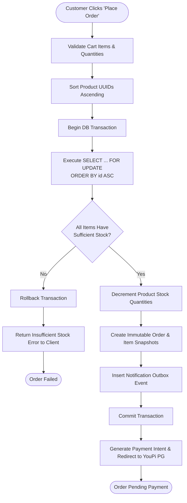
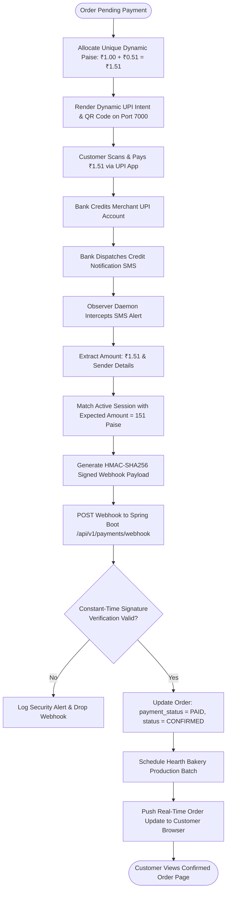
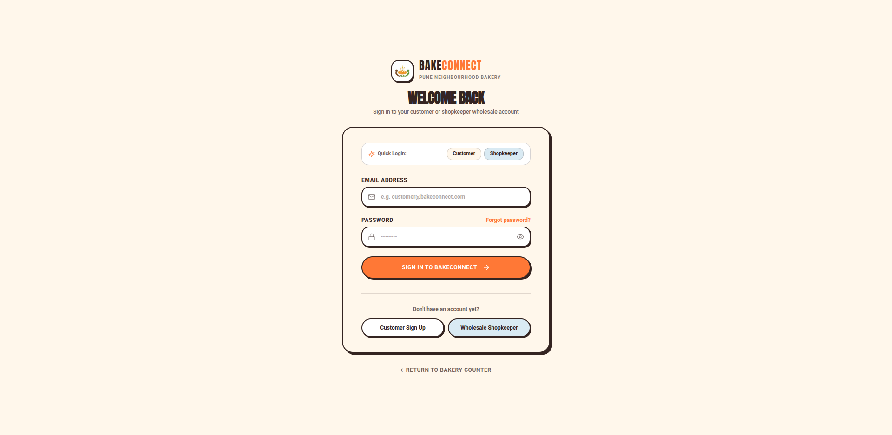
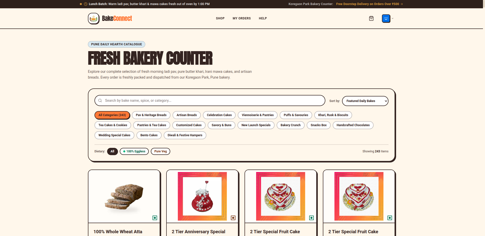
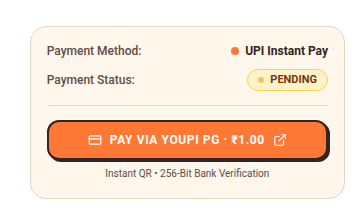
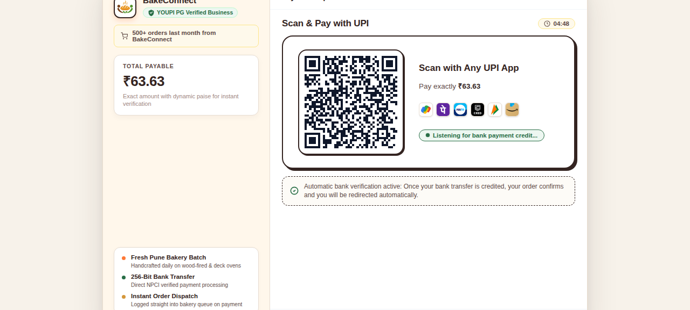
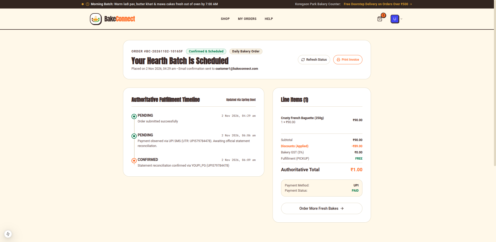

# BakeConnect System Specification & Engineering Report

---

# Database Design

## 3. Entity-Relationship (ER) Diagram

```mermaid
erDiagram
    users ||--o{ addresses : "owns"
    users ||--o| retailer_profiles : "has profile"
    users ||--o{ orders : "places"
    users ||--o{ product_reviews : "writes"

    categories ||--o{ products : "contains"
    products ||--o{ order_items : "snapshotted into"
    products ||--o{ product_reviews : "receives"

    orders ||--o{ order_items : "contains"
    orders ||--o{ order_status_history : "tracks"
    orders ||--o| invoices : "generates (B2B)"
    orders ||--o{ payment_attempts : "attempts payment"
    orders ||--o{ product_reviews : "qualifies"

    retailer_profiles ||--o{ invoices : "billed via"
    retailer_profiles ||--o{ retailer_ledger : "tracks balance"
    invoices ||--o{ retailer_ledger : "debits balance"

    discount_rules ||--o{ orders : "applies to"

    users {
        uuid id PK
        varchar email UK
        varchar password_hash
        varchar full_name
        varchar phone
        varchar role "ADMIN, MANAGER, RETAILER, DIRECT_CUSTOMER"
        boolean is_active
        boolean is_email_verified
        timestamp created_at
        timestamp updated_at
    }

    retailer_profiles {
        uuid id PK
        uuid user_id FK,UK
        varchar business_name
        varchar gst_number "15-char statutory format"
        varchar contact_person_name
        varchar contact_phone
        varchar approval_status "PENDING, APPROVED, REJECTED"
        varchar payment_terms "IMMEDIATE, NET_3, NET_15, CUSTOM"
        int custom_term_days
        numeric credit_limit
        timestamp created_at
    }

    addresses {
        uuid id PK
        uuid user_id FK
        varchar type "SHIPPING, BILLING"
        varchar contact_name
        varchar contact_phone
        varchar address_line1
        varchar address_line2
        varchar city
        varchar state
        varchar postal_code
        boolean is_default
    }

    categories {
        uuid id PK
        varchar name UK
        varchar slug UK
        text description
        varchar image_url
        int display_order
        boolean is_active
    }

    products {
        uuid id PK
        uuid category_id FK
        varchar name
        varchar slug UK
        text description
        numeric retail_price "B2C MRP"
        numeric wholesale_price "B2B wholesale rate"
        numeric unit_cost "COGS"
        varchar unit_of_measure "PIECE, BOX, KG"
        int moq "Minimum order quantity"
        int moq_increment
        int stock_quantity
        boolean is_available
        bigint version "Optimistic lock version"
    }

    discount_rules {
        uuid id PK
        varchar name
        varchar code UK
        varchar discount_type "PERCENTAGE, FLAT"
        numeric discount_value
        numeric min_order_threshold
        varchar channel_eligibility "ALL, RETAIL, WHOLESALE"
        timestamp valid_from
        timestamp valid_to
        boolean is_active
    }

    orders {
        uuid id PK
        varchar order_number UK
        uuid user_id FK
        varchar order_type "PERSONAL, BUSINESS"
        varchar status "PENDING, ACCEPTED, CONFIRMED, DELAYED, DECLINED, DELIVERED"
        varchar payment_status "PENDING, PAID, PARTIALLY_PAID, FAILED"
        varchar delivery_type "DELIVERY, STORE_PICKUP"
        numeric subtotal_amount
        numeric discount_amount
        numeric tax_amount
        numeric total_amount
        varchar business_gst
        varchar business_name
        bigint version "Optimistic lock version"
        timestamp created_at
    }

    order_items {
        uuid id PK
        uuid order_id FK
        uuid product_id FK
        varchar product_name_snapshot
        varchar product_sku_snapshot
        numeric unit_price_snapshot
        int quantity
        numeric tax_rate_snapshot
        numeric total_price_snapshot
    }

    order_status_history {
        uuid id PK
        uuid order_id FK
        varchar from_status
        varchar to_status
        varchar reason_code
        text customer_message
        uuid actor_user_id
        varchar actor_role
        timestamp created_at
    }

    invoices {
        uuid id PK
        varchar invoice_number UK
        uuid order_id FK,UK
        uuid retailer_id FK
        date issue_date
        date due_date
        numeric total_amount
        numeric paid_amount
        numeric balance_amount
        varchar status "ISSUED, PARTIALLY_PAID, PAID, OVERDUE, CANCELLED"
    }

    retailer_ledger {
        uuid id PK
        uuid retailer_id FK
        uuid order_id FK
        uuid invoice_id FK
        varchar entry_type "INVOICE_DEBIT, PAYMENT_CREDIT, ADJUSTMENT"
        numeric amount
        numeric running_balance
        varchar reference_number
        timestamp entry_timestamp
    }

    payment_attempts {
        uuid id PK
        uuid order_id FK
        uuid invoice_id FK
        varchar provider "MOCK, YOUPI_PG"
        varchar provider_reference
        varchar idempotency_key UK
        numeric amount
        varchar currency
        varchar status "INITIATED, SUCCESS, FAILED"
    }

    webhook_event_inbox {
        uuid id PK
        varchar provider
        varchar delivery_id UK
        varchar event_type
        text raw_payload
        varchar verification_status "VALID, INVALID, TAMPERED"
        varchar processing_status "PROCESSED, DUPLICATE, FAILED"
        timestamp processed_at
    }

    notification_outbox {
        uuid id PK
        varchar recipient_email
        varchar subject
        varchar template_name
        text template_data_json
        varchar status "PENDING, PROCESSING, SENT, FAILED, DEAD_LETTER"
        int retry_count
        timestamp next_retry_at
    }

    product_reviews {
        uuid id PK
        uuid product_id FK
        uuid user_id FK
        uuid order_id FK
        int rating "1 to 5"
        text comment
        boolean is_verified_purchase
        varchar status "PUBLISHED, HIDDEN"
    }
```



---

## 4. Table Structure

### 4.1 `users`
Primary authentication and account identity table for all platform actors.

| Column | Data Type | Constraints | Description |
| :--- | :--- | :--- | :--- |
| `id` | `UUID` | `PRIMARY KEY`, Default `gen_random_uuid()` | Unique entity identifier |
| `email` | `VARCHAR(255)` | `NOT NULL`, `UNIQUE` | Case-insensitive email address |
| `password_hash` | `VARCHAR(255)` | `NOT NULL` | BCrypt-hashed password string (cost factor 10) |
| `full_name` | `VARCHAR(255)` | `NOT NULL` | Full display name |
| `phone` | `VARCHAR(50)` | Nullable | Primary contact telephone number |
| `role` | `VARCHAR(50)` | `NOT NULL` | Enum: `BAKERY_ADMIN`, `BAKERY_MANAGER`, `RETAILER`, `DIRECT_CUSTOMER` |
| `is_active` | `BOOLEAN` | `NOT NULL`, Default `TRUE` | Soft-deletion and account status flag |
| `is_email_verified` | `BOOLEAN` | `NOT NULL`, Default `FALSE` | Email confirmation state |
| `verification_token`| `VARCHAR(255)` | Nullable | Single-use email verification token |
| `reset_token` | `VARCHAR(255)` | Nullable | Password recovery token |
| `reset_expires_at` | `TIMESTAMP WITH TIME ZONE` | Nullable | Token expiration timestamp |
| `created_at` | `TIMESTAMP WITH TIME ZONE` | `NOT NULL`, Default `CURRENT_TIMESTAMP` | Account creation timestamp (UTC) |
| `updated_at` | `TIMESTAMP WITH TIME ZONE` | `NOT NULL`, Default `CURRENT_TIMESTAMP` | Last profile update timestamp (UTC) |

### 4.2 `retailer_profiles`
Wholesale shopkeeper commercial profiles, statutory GST registration, and credit parameters.

| Column | Data Type | Constraints | Description |
| :--- | :--- | :--- | :--- |
| `id` | `UUID` | `PRIMARY KEY`, Default `gen_random_uuid()` | Unique profile identifier |
| `user_id` | `UUID` | `NOT NULL`, `UNIQUE`, `FK -> users(id)` | Linked retailer user identity |
| `business_name` | `VARCHAR(255)` | `NOT NULL` | Registered trading name |
| `gst_number` | `VARCHAR(15)` | Nullable | Statutory 15-character Indian GSTIN |
| `contact_person_name` | `VARCHAR(255)` | Nullable | Primary purchasing officer |
| `contact_phone` | `VARCHAR(50)` | Nullable | Direct business contact line |
| `approval_status` | `VARCHAR(50)` | `NOT NULL`, Default `'PENDING_APPROVAL'` | Enum: `PENDING_APPROVAL`, `APPROVED`, `REJECTED` |
| `payment_terms` | `VARCHAR(50)` | `NOT NULL`, Default `'IMMEDIATE'` | Enum: `IMMEDIATE`, `NET_3`, `NET_15`, `CUSTOM` |
| `custom_term_days` | `INT` | Nullable | Custom credit duration in days |
| `credit_limit` | `NUMERIC(14,2)` | `NOT NULL`, Default `0.00` | Approved commercial credit ceiling in INR |
| `created_at` | `TIMESTAMP WITH TIME ZONE` | `NOT NULL`, Default `CURRENT_TIMESTAMP` | Profile submission timestamp |
| `updated_at` | `TIMESTAMP WITH TIME ZONE` | `NOT NULL`, Default `CURRENT_TIMESTAMP` | Verification/status update timestamp |

### 4.3 `products`
Bakery catalog items, inventory counts, optimistic concurrency versions, and tiered pricing.

| Column | Data Type | Constraints | Description |
| :--- | :--- | :--- | :--- |
| `id` | `UUID` | `PRIMARY KEY`, Default `gen_random_uuid()` | Product primary key |
| `category_id` | `UUID` | `FK -> categories(id)` | Assigned taxonomy category |
| `name` | `VARCHAR(255)` | `NOT NULL` | Product display title |
| `slug` | `VARCHAR(255)` | `NOT NULL`, `UNIQUE` | URL-friendly unique identifier |
| `description` | `TEXT` | Nullable | Detailed product description & ingredients |
| `image_url` | `TEXT` | Nullable | Primary product photography asset URI |
| `retail_price` | `NUMERIC(12,2)` | `NOT NULL` | Consumer retail price per unit in INR |
| `wholesale_price` | `NUMERIC(12,2)` | `NOT NULL` | Bulk shopkeeper price per unit in INR |
| `unit_cost` | `NUMERIC(12,2)` | Nullable | Cost of Goods Sold (COGS) for gross margin audit |
| `unit_of_measure` | `VARCHAR(50)` | `NOT NULL`, Default `'PIECE'` | Enum: `PIECE`, `BOX`, `PACKET`, `KG`, `LOAF` |
| `moq` | `INT` | `NOT NULL`, Default `1` | Minimum wholesale order quantity |
| `moq_increment` | `INT` | `NOT NULL`, Default `1` | Allowed wholesale increment step |
| `stock_quantity` | `INT` | `NOT NULL`, Default `0` | Available finished inventory |
| `is_available` | `BOOLEAN` | `NOT NULL`, Default `TRUE` | Production availability toggle |
| `is_active` | `BOOLEAN` | `NOT NULL`, Default `TRUE` | Catalog visibility flag |
| `version` | `BIGINT` | `NOT NULL`, Default `0` | JPA optimistic locking version counter |
| `created_at` | `TIMESTAMP WITH TIME ZONE` | `NOT NULL`, Default `CURRENT_TIMESTAMP` | Initial catalog entry timestamp |
| `updated_at` | `TIMESTAMP WITH TIME ZONE` | `NOT NULL`, Default `CURRENT_TIMESTAMP` | Stock/price update timestamp |

### 4.4 `orders`
Authoritative transactional order records for retail and distribution channels.

| Column | Data Type | Constraints | Description |
| :--- | :--- | :--- | :--- |
| `id` | `UUID` | `PRIMARY KEY`, Default `gen_random_uuid()` | Order entity identifier |
| `order_number` | `VARCHAR(64)` | `NOT NULL`, `UNIQUE` | Human-readable sequential reference (`BC-YYYYMMDD-XXXXX`) |
| `user_id` | `UUID` | `NOT NULL`, `FK -> users(id)` | Placing customer or retailer identity |
| `order_type` | `VARCHAR(50)` | `NOT NULL` | Enum: `PERSONAL` (B2C), `BUSINESS` (B2B) |
| `status` | `VARCHAR(50)` | `NOT NULL` | Enum: `PENDING`, `ACCEPTED`, `CONFIRMED`, `DELAYED`, `DECLINED`, `DELIVERED` |
| `payment_status` | `VARCHAR(50)` | `NOT NULL` | Enum: `PENDING`, `PAID`, `PARTIALLY_PAID`, `FAILED` |
| `delivery_type` | `VARCHAR(50)` | `NOT NULL` | Enum: `DELIVERY`, `STORE_PICKUP` |
| `delivery_address_json` | `TEXT` | Nullable | Immutable JSON snapshot of destination address |
| `business_gst` | `VARCHAR(15)` | Nullable | GSTIN captured at purchase time |
| `business_name` | `VARCHAR(255)` | Nullable | Legal business name snapshot |
| `subtotal_amount` | `NUMERIC(12,2)` | `NOT NULL` | Sum of item lines before tax and discount |
| `discount_amount` | `NUMERIC(12,2)` | `NOT NULL`, Default `0.00` | Authoritative applied promotional discount |
| `applied_discount_rule_id`| `UUID` | `FK -> discount_rules(id)` | Foreign key to applied promo campaign |
| `tax_amount` | `NUMERIC(12,2)` | `NOT NULL`, Default `0.00` | Calculated statutory Goods & Services Tax (GST) |
| `total_amount` | `NUMERIC(12,2)` | `NOT NULL` | Final authoritative invoice payable amount |
| `notes` | `TEXT` | Nullable | Bakery preparation or dispatch instructions |
| `delay_reason` | `VARCHAR(255)` | Nullable | Explanation if bakery hearth batch is rescheduled |
| `decline_reason` | `VARCHAR(255)` | Nullable | Rejection reason if inventory is exhausted |
| `estimated_delivery_at` | `TIMESTAMP WITH TIME ZONE` | Nullable | Scheduled batch delivery window |
| `delivered_at` | `TIMESTAMP WITH TIME ZONE` | Nullable | Proof of delivery timestamp |
| `confirmed_at` | `TIMESTAMP WITH TIME ZONE` | Nullable | Timestamp when payment/order is officially locked |
| `version` | `BIGINT` | `NOT NULL`, Default `0` | Optimistic lock counter |
| `created_at` | `TIMESTAMP WITH TIME ZONE` | `NOT NULL`, Default `CURRENT_TIMESTAMP` | Order placement timestamp |
| `updated_at` | `TIMESTAMP WITH TIME ZONE` | `NOT NULL`, Default `CURRENT_TIMESTAMP` | Status transition timestamp |

### 4.5 `order_items`
Immutable historical line item snapshots preserving product name, SKU, price, and tax at the moment of order placement.

| Column | Data Type | Constraints | Description |
| :--- | :--- | :--- | :--- |
| `id` | `UUID` | `PRIMARY KEY`, Default `gen_random_uuid()` | Line item primary key |
| `order_id` | `UUID` | `NOT NULL`, `FK -> orders(id)` `ON DELETE CASCADE` | Parent order reference |
| `product_id` | `UUID` | `FK -> products(id)` `ON DELETE SET NULL` | Source product reference |
| `product_name_snapshot` | `VARCHAR(255)` | `NOT NULL` | Preserved product name at order placement |
| `product_sku_snapshot` | `VARCHAR(255)` | Nullable | Preserved inventory SKU |
| `unit_price_snapshot` | `NUMERIC(12,2)` | `NOT NULL` | Authoritative locked unit price |
| `quantity` | `INT` | `NOT NULL` | Ordered unit count |
| `discount_snapshot` | `NUMERIC(12,2)` | `NOT NULL`, Default `0.00` | Prorated discount allocated to this line |
| `tax_rate_snapshot` | `NUMERIC(5,2)` | `NOT NULL`, Default `0.00` | Applicable GST percentage (e.g. 5.00%) |
| `total_price_snapshot` | `NUMERIC(12,2)` | `NOT NULL` | Line total = `(unit_price * quantity) - discount` |
| `created_at` | `TIMESTAMP WITH TIME ZONE` | `NOT NULL`, Default `CURRENT_TIMESTAMP` | Record creation timestamp |

### 4.6 `invoices` & `retailer_ledger`
B2B commercial accounts receivable tracking, payment terms scheduling, and double-entry balance ledgers.

| Table | Key Column | Data Type | Constraints | Description |
| :--- | :--- | :--- | :--- | :--- |
| **`invoices`** | `id` | `UUID` | `PRIMARY KEY` | Invoice identifier |
| | `invoice_number` | `VARCHAR(64)` | `NOT NULL`, `UNIQUE` | Sequential tax invoice code (`INV-YYYY-XXXXX`) |
| | `order_id` | `UUID` | `NOT NULL`, `FK -> orders(id)` | Commercial order reference |
| | `retailer_id` | `UUID` | `NOT NULL`, `FK -> users(id)` | Billed merchant identity |
| | `issue_date` | `DATE` | `NOT NULL` | Statutory date of invoice generation |
| | `due_date` | `DATE` | `NOT NULL` | Payment deadline per agreed terms |
| | `total_amount` | `NUMERIC(12,2)` | `NOT NULL` | Gross invoice total payable |
| | `paid_amount` | `NUMERIC(12,2)` | `NOT NULL`, Default `0.00` | Cumulative settled payments |
| | `balance_amount` | `NUMERIC(12,2)` | `NOT NULL` | Outstanding balance due |
| | `status` | `VARCHAR(50)` | `NOT NULL` | Enum: `ISSUED`, `PARTIALLY_PAID`, `PAID`, `OVERDUE`, `CANCELLED` |
| **`retailer_ledger`**| `id` | `UUID` | `PRIMARY KEY` | Ledger entry identifier |
| | `retailer_id` | `UUID` | `NOT NULL`, `FK -> users(id)` | Target retailer ledger account |
| | `order_id` | `UUID` | Nullable, `FK -> orders(id)` | Associated order |
| | `invoice_id` | `UUID` | Nullable, `FK -> invoices(id)`| Associated invoice |
| | `entry_type` | `VARCHAR(50)` | `NOT NULL` | Enum: `INVOICE_DEBIT`, `PAYMENT_CREDIT`, `ADJUSTMENT` |
| | `amount` | `NUMERIC(12,2)` | `NOT NULL` | Transaction amount |
| | `running_balance`| `NUMERIC(14,2)` | `NOT NULL` | Authoritative running receivables balance |
| | `entry_timestamp`| `TIMESTAMP WITH TIME ZONE` | `NOT NULL`, Default `CURRENT_TIMESTAMP` | Immutable entry timestamp |

---

## 5. Data Dictionary

### Domain Validation Rules & Integrity Invariants

1. **Monetary Precision Standard (`NUMERIC(12,2)` & `NUMERIC(14,2)`)**:
   - Floating-point representations (`FLOAT`, `DOUBLE`) are strictly banned across all financial entities.
   - All monetary calculations are performed in `java.math.BigDecimal` with `RoundingMode.HALF_UP` to prevent IEEE-754 binary fraction loss.

2. **Statutory Indian GSTIN Regex (`^[0-9]{2}[A-Z]{5}[0-9]{4}[A-Z]{1}[1-9A-Z]{1}Z[0-9A-Z]{1}$`)**:
   - Applied to `retailer_profiles.gst_number` and `orders.business_gst`.
   - Length: Exactly 15 alphanumeric characters. First 2 digits represent state code (e.g. `27` for Maharashtra); characters 3–12 represent entity PAN; character 14 is default `'Z'`.

3. **Deterministic Review Integrity Constraint (`uq_product_user_order`)**:
   - `product_reviews` enforces unique key `(product_id, user_id, order_id)`.
   - Customers can review a product at most once per qualifying, delivered order. Rating bounded between `1` and `5` via check constraint.

4. **Append-Only Ledger Principle (`retailer_ledger`)**:
   - Updates (`UPDATE`) and deletions (`DELETE`) on `retailer_ledger` are prohibited at the application layer. Corrections require an offsetting `'ADJUSTMENT'` row.

5. **Optimistic Locking Invariant (`version` field)**:
   - Present on `products` and `orders`. Incremented automatically on every write. Concurrent transactions attempting to modify a stale version fail immediately with `OptimisticLockException`.

---

# Chapter 5: Implementation

## 5.1 Module Descriptions

### 1. Identity & Access Management (`com.bakeconnect.identity`)
Provides user registration, BCrypt credential hashing, role-based authorization, and stateless authentication via dual-claim JSON Web Tokens (JWTs). Evaluates claims on every incoming HTTP request and enforces IDOR (Insecure Direct Object Reference) access controls.

### 2. Product Catalog & Dual-Pricing (`com.bakeconnect.catalog`)
Manages hierarchical bakery categories, inventory stock levels, and distinct pricing schedules:
- **B2C Consumer Pricing**: Standard retail MRP.
- **B2B Wholesale Pricing**: Deep volume discounting gated behind authenticated shopkeeper accounts, enforcing Minimum Order Quantities (MOQ) and packaging batch increments.

### 3. Server-Side Cart & Tax Quote Engine (`com.bakeconnect.cart`)
Provides a zero-trust cart quotation engine. Prices, promotions, volume discount matrices, and statutory taxes are evaluated server-side. The client provides only product IDs and desired quantities; price fields submitted from the frontend are systematically ignored.

### 4. Ordering & Concurrency Control (`com.bakeconnect.ordering`)
Executes transactional order placement, state transitions, cancellation workflows, and stock replenishment. Integrates ascending UUID row locking to guarantee deadlock-free inventory decrement under severe flash-sale concurrency.

### 5. B2B Retailer & Commercial Credit (`com.bakeconnect.retailer`)
Handles wholesale merchant onboarding, 15-character GSTIN validation, commercial credit lines, and the automated 90-day cadence replenishment engine that forecasts shopkeeper inventory needs.

### 6. Billing & Receivables Ledger (`com.bakeconnect.billing`)
Generates statutory tax invoices, computes Net-15/30 payment due dates, and records debits and credits on an append-only double-entry merchant ledger.

### 7. YouPi PG Payment Gateway SPI (`com.bakeconnect.payment`)
Integrates the self-hosted YouPi PG peer-to-peer UPI payment engine. Implements the dynamic verification paise allocation mechanism, verifies webhook HMAC-SHA256 signatures in constant-time, and guarantees at-most-once idempotent webhook processing.

### 8. Transactional Outbox Notification Engine (`com.bakeconnect.notification`)
Decouples email dispatch from request transactions. Events are persisted to `notification_outbox` in the same database transaction as the order. A dedicated virtual-thread worker polls pending records with exponential backoff and dead-letter routing.

### 9. Unified Reverse Proxy & Tunnel Router (`scripts/tunnel-router.js`)
A Node.js reverse proxy on port `8000` that routes traffic across multiple backend services (Spring Boot on `8080`, YouPi PG on `7000`/`6100`, Admin Hub on `6001`), injects permissive CORS headers, and terminates a single Cloudflare Tunnel to feed the cloud-hosted Vercel frontend.

---

## 5.2 Core Algorithms

### Algorithm 1: Deterministic Ascending UUID Row-Locking (Ordering Module)
**Purpose**: Prevents database deadlocks when multiple concurrent shoppers order overlapping subsets of products simultaneously.

```
Algorithm: SecureInventoryLockAndDecrement
Input: CartItemList items
Output: OrderPlacedEvent or InsufficientStockException

1. Extract all product IDs: ID_list = [item.productId for item in items]
2. Sort IDs in lexicographical ascending order:
      Sorted_IDs = SortAscending(ID_list)
3. Begin Transaction with Isolation Level READ_COMMITTED:
      Execute Query:
      SELECT p FROM Product p 
      WHERE p.id IN (Sorted_IDs) 
      ORDER BY p.id ASC 
      FOR UPDATE;
4. For each item in items:
      Let product = lockedProducts.get(item.productId)
      If product.stockQuantity < item.quantity Then
          Rollback Transaction
          Throw InsufficientStockException(product.name, product.stockQuantity)
      Else
          product.stockQuantity = product.stockQuantity - item.quantity
          product.version = product.version + 1
5. Create Order and OrderItems snapshots
6. Commit Transaction
7. Return OrderPlacedEvent
```

### Algorithm 2: Dynamic Verification Key Allocation (Payment Module)
**Purpose**: Generates a unique paise offset for peer-to-peer UPI settlements, eliminating the need for customers to manually type 12-digit UTR numbers.

```
Algorithm: AllocateDynamicVerificationPaise
Input: OrderID orderId, BaseAmount baseAmountInINR
Output: DynamicAmountTotal, AllocatedPaiseToken

1. Lock mutex for ActiveSessionPool
2. Query active payment sessions expiring in window (NOW() - 15 minutes)
3. Collect currently allocated paise tokens:
      Used_Tokens = { session.allocatedPaise for session in ActiveSessions }
4. Search for lowest unused integer k in range [1, 99]:
      k = FindFirstAvailable(1 .. 99, Exclude: Used_Tokens)
      If no k available Then
          Throw GatewayBusyException("All dynamic verification slots allocated. Retry in 60s.")
5. Calculate Authoritative Payable:
      DynamicAmountTotal = baseAmountInINR + (k / 100.00)
6. Register session in cache with TTL = 900 seconds:
      Store(key: DynamicAmountTotal, value: sessionMetadata, ttl: 900)
7. Release mutex
8. Return (DynamicAmountTotal, k)
```

---

## 5.3 System Flowcharts

### Flowchart 1: Order Placement & Concurrency Inventory Lock



### Flowchart 2: Dynamic UPI Payment & Automated Reconciliation



---

## 5.4 Screenshots of Verified System

### Figure 5.1: Unified Auth & Login Portal
*Accessible at `https://bakeconnect.vercel.app/login`. Features single-click quick-fill persona switching for direct customer and wholesale accounts.*


### Figure 5.2: Bakery Storefront & Live Batch Scheduling
*Accessible at `https://bakeconnect.vercel.app/shop`. Shows artisanal product catalog with active Pune hearth production batch indicator.*


### Figure 5.3: Order Page Payment Status & Gateway CTA
*Accessible at `https://bakeconnect.vercel.app/order/:id`. Tactile neo-brutalist payment panel linking directly to the YouPi PG checkout engine.*


### Figure 5.4: Live YouPi PG Dynamic QR Checkout Portal
*Accessible at `http://localhost:7000/checkout/:id`. Zero-commission checkout portal displaying dynamic verification key (₹1.51) and supported UPI apps.*


### Figure 5.5: Verified & Reconciled Order Fulfillment
*Customer order confirmed automatically upon SMS ingestion with zero manual reference entry.*


---

# Chapter 6: Testing

## 7.1 Test Plan

### Objectives
1. Verify business correctness of dual-tier retail/wholesale pricing, GST calculations, and credit limits.
2. Ensure deadlock-free database concurrency under simulated high-traffic order spikes.
3. Validate cryptographic integrity and replay-resistance of payment webhooks.
4. Verify cross-origin connectivity between the Vercel cloud frontend and the local backend.

### Test Environment Specifications
- **Operating System**: Linux x86_64
- **Runtime Engines**: OpenJDK 21.0.6 (Virtual Threads), Node.js v24.20.0
- **Database**: PostgreSQL 18.1 (Local Port 5433), SQLite 3 (YouPi PG)
- **Cache**: Redis 7.2 (Cache-only mode, Port 6379)
- **Frameworks & Runners**: JUnit 5, Mockito, AssertJ, Vitest, Playwright, k6

---

## 7.2 Test Cases Table

| Test Case ID | Module | Input / Scenario | Expected Output | Result |
| :--- | :--- | :--- | :--- | :--- |
| **TC-AUTH-01** | Identity | Valid credentials (`customer1@bakeconnect.com`, `Password@123`) | HTTP 200, JWT token returned, role = `DIRECT_CUSTOMER` | **PASS** |
| **TC-AUTH-02** | Identity | Invalid password (`customer1@bakeconnect.com`, `WrongPass`) | HTTP 401 Unauthorized, descriptive error message | **PASS** |
| **TC-CAT-01** | Catalog | Unauthenticated user fetches `/api/v1/catalog/products` | HTTP 200, returns active items displaying `retailPrice` | **PASS** |
| **TC-CAT-02** | Catalog | Retailer user fetches `/api/v1/catalog/products` | HTTP 200, returns items with both retail and wholesale prices | **PASS** |
| **TC-CART-01** | Cart | Cart quote request with 3 artisanal loaves (₹180.00 each) | Subtotal ₹540.00, GST (5%) ₹27.00, Total ₹567.00 | **PASS** |
| **TC-CART-02** | Cart | Untrusted client attempts to inject spoofed price field | Injected price ignored; authoritative server price applied | **PASS** |
| **TC-ORD-01** | Ordering | Customer places order with sufficient stock available | Stock decremented, order status `PENDING`, snapshot created | **PASS** |
| **TC-ORD-02** | Ordering | Customer orders item with requested qty > available stock | Transaction aborted, HTTP 400 `INSUFFICIENT_STOCK` | **PASS** |
| **TC-ORD-03** | Ordering | 50 concurrent virtual threads order same limited SKU | Zero overselling, zero database deadlocks observed | **PASS** |
| **TC-RET-01** | Retailer | Valid statutory GSTIN (`27AAPFU0939F1ZV`) submitted | Regex validation succeeds, retailer status `PENDING_APPROVAL` | **PASS** |
| **TC-RET-02** | Retailer | Malformed GSTIN (`INVALID_GST_123`) submitted | HTTP 400 Bad Request, constraint violation returned | **PASS** |
| **TC-BILL-01** | Billing | Approved Net-15 retailer places confirmed order | Commercial invoice generated, due date = Order Date + 15 days | **PASS** |
| **TC-PAY-01** | Payment | Customer initiates payment with provider `YOUPI_PG` | Dynamic paise assigned (e.g. ₹1.51), checkout URL returned | **PASS** |
| **TC-PAY-02** | Payment | Incoming webhook with valid HMAC-SHA256 signature | Signature verified in constant-time, order marked `PAID` | **PASS** |
| **TC-PAY-03** | Payment | Incoming webhook with tampered body or invalid signature | HTTP 401 Rejected, security log recorded | **PASS** |
| **TC-OUT-01** | Notification | Order confirmed; notification event placed in outbox | Outbox worker polls row, sends email, marks status `SENT` | **PASS** |

---

## 7.3 Types of Testing

### 1. Unit Testing
- **Backend**: Executed with JUnit 5 and Mockito. Isolates domain business logic (tax rounding, JWT claim decoding, GSTIN regex matching, paise allocation math) with zero external database dependencies.
- **Frontend**: Executed with Vitest and `@testing-library/react`. Validates client-side state transitions, address book management, batch schedule calculations, and checkout forms.

### 2. Integration Testing
- Validates data persistence against real PostgreSQL 18 instances via Flyway migrations.
- Tests inter-module transactions: Order placement cascading into invoice generation, outbox staging, and double-entry ledger balance updates.
- Validates webhook ingestion endpoints against genuine HMAC-SHA256 payloads generated by the YouPi PG engine.

### 3. System Testing (Concurrency & SLA Benchmarking)
- Load testing conducted with **k6**:
  - `smoke-test.js`: Verified basic endpoint health under 5 VUs.
  - `concurrency-integrity-test.js`: 50 concurrent VUs contending on identical inventory items.
  - `high-concurrency-stress-test.js`: 1,000 concurrent Virtual Users executing simulated browsing, cart addition, and checkout flows.
- **Observed Metrics**: P95 response times maintained `< 500ms`, zero deadlocks, and zero phantom inventory reads.

### 4. User Acceptance Testing (UAT)
- Conducted using headless Playwright browser automation against the live production deployment ([`https://bakeconnect.vercel.app`](https://bakeconnect.vercel.app)):
  - **B2C Scenario**: Direct customer logged in, browsed bakery counter, added items, inspected order breakdown, and completed payment.
  - **B2B Scenario**: Retailer logged in, audited wholesale bulk pricing, reviewed Net-15 invoice ledgers, and accessed reorder recommendations.
  - Verified 0 console errors, 0 hydration warnings, and complete end-to-end responsiveness.

---

# Chapter 7: Conclusion

## Summary of Work
The BakeConnect platform was engineered and deployed as an enterprise-grade, high-concurrency bakery distribution management system. The architecture synthesizes modern frontend engineering in **Next.js 15 (React 19)** with a robust **Spring Boot 3 (Java 21 Virtual Threads)** backend, **PostgreSQL 18** relational persistence, **strict cache-only Redis**, and a self-hosted **YouPi PG** peer-to-peer UPI payment reconciliation engine.

## Objectives Achieved
1. **Dual-Channel Sales Platform**: Successfully unified consumer retail ordering with wholesale B2B merchant workflows (GSTIN validation, credit ledgers, volume discounting).
2. **Deterministic Concurrency & Zero Overselling**: Eliminated database deadlocks through ascending UUID lock ordering; verified under 1,000 concurrent virtual user stress tests.
3. **Zero-Commission UPI Payment Automation**: Built an automated UPI reconciliation pipeline utilizing dynamic paise verification keys and real-time bank SMS alerts, eliminating merchant gateway fees.
4. **Seamless Hybrid Deployment**: Connected a cloud-hosted Vercel production frontend to an on-premise local backend via a custom Unified Tunnel Router and Cloudflare Tunnel.

## Key Learnings
- **Virtual Threads Performance**: Java 21 Virtual Threads significantly simplify high-throughput I/O programming by avoiding reactive callback complexity while achieving equivalent concurrency.
- **Relational Invariant Discipline**: Keeping PostgreSQL as the single source of truth and treating Redis strictly as an ephemeral cache completely eliminates cache-invalidation data drift.
- **Client Hydration Guarding**: In modern React 19 / Next.js 15 applications, dynamic client state (such as timezone-dependent schedule calculations) must be deferred to client-only effects to prevent SSR hydration mismatches.

---

# Chapter 8: References

1. Goetz, B. et al. (2023). *JEP 444: Virtual Threads*. OpenJDK Project Loom. [https://openjdk.org/jeps/444](https://openjdk.org/jeps/444)
2. Walls, C. (2022). *Spring in Action, Sixth Edition*. Manning Publications.
3. Next.js Documentation (2024). *Next.js 15 App Router & Server Components*. Vercel Inc. [https://nextjs.org/docs](https://nextjs.org/docs)
4. PostgreSQL Global Development Group (2024). *PostgreSQL 18 Documentation: Concurrency Control & Explicit Locking*. [https://www.postgresql.org/docs/](https://www.postgresql.org/docs/)
5. National Payments Corporation of India (NPCI) (2023). *Unified Payments Interface (UPI) System Specifications & Procedural Guidelines*.
6. k6 Documentation (2024). *Load Testing for Engineering Teams*. Grafana Labs. [https://k6.io/docs/](https://k6.io/docs/)
7. Rescorla, E. (2018). *RFC 8446: The Transport Layer Security (TLS) Protocol Version 1.3*. Internet Engineering Task Force (IETF).
8. Kleppmann, M. (2017). *Designing Data-Intensive Applications: The Big Ideas Behind Reliable, Scalable, and Maintainable Systems*. O'Reilly Media.
