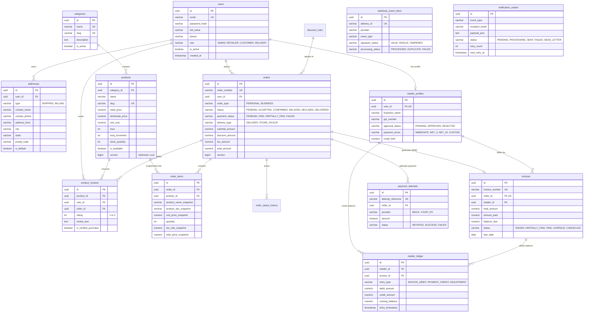

# BakeConnect Database Entity-Relationship Model & Schema Documentation

- **Database:** PostgreSQL 18+
- **Migration Authority:** Flyway (`V1__init_schema.sql`, `V2__performance_indexes.sql`, `V3__seed_data.sql`)
- **Persistence Layer:** Spring Data JPA + Hibernate (No Prisma, No secondary schema mutator)
- **Currency & Money:** Explicit `NUMERIC(12,2)` (Strictly zero floating-point arithmetic)
- **Timestamps:** UTC `TIMESTAMP WITH TIME ZONE`

---

## 1. Mermaid Entity-Relationship Diagram

---

## 2. Invariant Rules Enforced by Schema

1. **Unique Review Invariant**: `uq_product_user_order (product_id, user_id, order_id)` guarantees a customer can review a purchased item at most once per qualifying delivered order.
2. **Immutable Snapshots**: `order_items` stores historical copies of `product_name_snapshot`, `product_sku_snapshot`, `unit_price_snapshot`, and `tax_rate_snapshot`. Subsequent product updates in `products` never alter past invoices.
3. **Optimistic Locking**: `products.version` and `orders.version` prevent concurrent read-modify-write lost updates.
4. **Deterministic Deadlock Prevention**: Enforced at the application transaction boundary via ascending UUID sort before issuing `SELECT ... FOR UPDATE` row locks.
5. **Append-Only Receivables Ledger**: Double-entry ledger structure recording `INVOICE_DEBIT`, `PAYMENT_CREDIT`, and `ADJUSTMENT`. Direct SQL mutation of historical ledger rows is disallowed.
